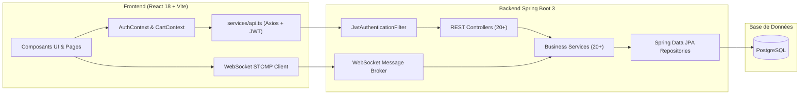
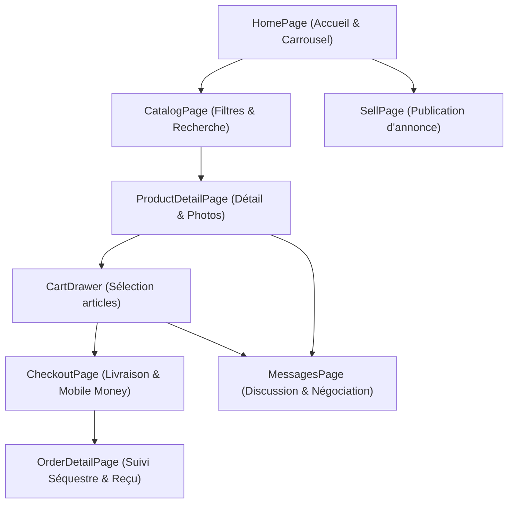
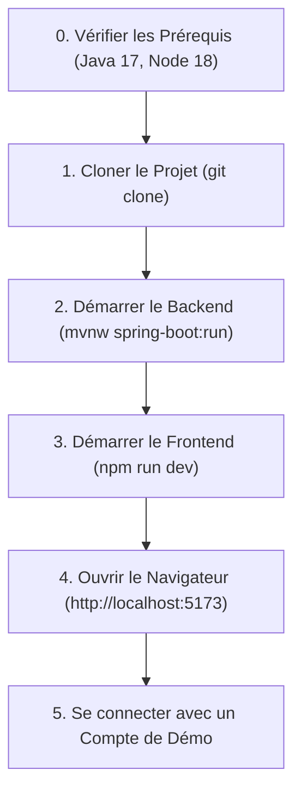

# Documentation Complète de Bout en Bout — ReVibe FliP

> **Plateforme sénégalaise et sous-régionale de seconde main & mode circulaire**
> *Stack technique : Spring Boot 3 (Java 17) • PostgreSQL • React 18 (TypeScript, Vite, Tailwind CSS) • WebSocket • Séquestre Mobile Money (Wave, Orange Money)*

---

## Sommaire Général

1. [Vue d'Ensemble & Architecture Système](#1-vue-densemble--architecture-système)
2. [Modèle de Données & Entités JPA (Backend)](#2-modèle-de-données--entités-jpa-backend)
3. [Couche Sécurité & Authentification (Backend)](#3-couche-sécurité--authentification-backend)
4. [Couche Contrôleurs REST & WebSocket (Backend)](#4-couche-contrôleurs-rest--websocket-backend)
5. [Couche Services Métier (Backend)](#5-couche-services-métier-backend)
6. [Couche Repositories & DTOs (Backend)](#6-couche-repositories--dtos-backend)
7. [Architecture Frontend (React 18 / TypeScript)](#7-architecture-frontend-react-18--typescript)
8. [Composants UI & Navigation (Frontend)](#8-composants-ui--navigation-frontend)
9. [Pages & Parcours Utilisateur (Frontend)](#9-pages--parcours-utilisateur-frontend)
10. [Gestion d'État & Client API (Frontend)](#10-gestion-détat--client-api-frontend)
11. [Configuration, DevOps & Conception UML](#11-configuration-devops--conception-uml)

---

## 1. Vue d'Ensemble & Architecture Système

ReVibe FliP est une marketplace C2C/B2C dédiée à la mode de seconde main en Afrique de l'Ouest (Sénégal en tête). Son architecture repose sur :
- **Un Backend Spring Boot 3 robuste** : API RESTful sécurisée par JWT, WebSocket STOMP pour la messagerie instantanée, services d'escrow (paiement sous séquestre avec libération conditionnelle), et gestion CMS/Back-office.
- **Un Frontend React 18 / Vite ultra-rapide** : Typage TypeScript strict, design system Tailwind CSS inspiré des leaders internationaux (Vinted, Vestiaire Collective), panier mono-vendeur sécurisé, et parcours d'achat sans friction.
- **Paiements Locaux** : Intégration simulée et prête pour Wave et Orange Money avec frais de protection sous séquestre (1%).



---

## 2. Modèle de Données & Entités JPA (Backend)

Toutes les entités se trouvent dans `backend/src/main/java/com/revibeflip/entity/` :

### 2.1 Utilisateurs & Profils
- [`User.java`](file:///c:/Users/falla/Desktop/revibe-flip/backend/src/main/java/com/revibeflip/entity/User.java) : Utilisateur principal (Acheteur, Vendeur, Administrateur). Contient téléphone (`phone`), mot de passe haché BCrypt, prénom, nom, rôle (`ROLE_USER`, `ROLE_ADMIN`), score de confiance (`trustScore`), badge vérifié (`isVerified`), statut suspension (`isSuspended`), et relations vers annonces, commandes, avis et adresses.
- [`Address.java`](file:///c:/Users/falla/Desktop/revibe-flip/backend/src/main/java/com/revibeflip/entity/Address.java) : Carnet d'adresses multiples pour un acheteur (quartier, ville, repères GPS, téléphone de contact).
- [`Country.java`](file:///c:/Users/falla/Desktop/revibe-flip/backend/src/main/java/com/revibeflip/entity/Country.java) : Pays supportés (Sénégal, Côte d'Ivoire, etc.) avec code ISO (`SN`), indicatif (`+221`), devise (`XOF`) et drapeau emoji.

### 2.2 Produits & Catalogue
- [`Product.java`](file:///c:/Users/falla/Desktop/revibe-flip/backend/src/main/java/com/revibeflip/entity/Product.java) : Article mis en vente. Titre, description, prix unitaire, prix d'origine, marque, taille, couleur, état (`NEW_WITH_TAG`, `VERY_GOOD`, `GOOD`, `ACCEPTABLE`), statut (`ACTIVE`, `RESERVED`, `SOLD`, `SUSPENDED`), catégorie, vendeur, ville de localisation et compteurs de vues.
- [`ProductImage.java`](file:///c:/Users/falla/Desktop/revibe-flip/backend/src/main/java/com/revibeflip/entity/ProductImage.java) : Galerie d'images d'un produit avec drapeau `isPrimary` et ordre d'affichage (`displayOrder`).
- [`Category.java`](file:///c:/Users/falla/Desktop/revibe-flip/backend/src/main/java/com/revibeflip/entity/Category.java) : Arborescence de catégories (Femmes, Hommes, Mode Traditionnelle & Wax, Chaussures, Sacs, Bijoux) avec slug, icône et statut actif.

### 2.3 Panier & Commandes
- [`Cart.java`](file:///c:/Users/falla/Desktop/revibe-flip/backend/src/main/java/com/revibeflip/entity/Cart.java) : Panier d'un acheteur. Contraint par la règle d'or ReVibe FliP : **Mono-vendeur** (un panier ne regroupe que les articles d'un même vendeur pour garantir un séquestre et une expédition groupée cohérente).
- [`CartItem.java`](file:///c:/Users/falla/Desktop/revibe-flip/backend/src/main/java/com/revibeflip/entity/CartItem.java) : Ligne d'article du panier. Quantité = 1 stricte (règle pièce unique de seconde main).
- [`Order.java`](file:///c:/Users/falla/Desktop/revibe-flip/backend/src/main/java/com/revibeflip/entity/Order.java) : Commande passée. Montant articles, frais de livraison, frais de séquestre (1%), statut (`PENDING_PAYMENT`, `ESCROW_LOCKED`, `SHIPPED`, `DELIVERED`, `COMPLETED`, `CANCELLED`, `DISPUTED`), mode de livraison (`HOME_DELIVERY`, `HAND_DELIVERY`).
- [`OrderItem.java`](file:///c:/Users/falla/Desktop/revibe-flip/backend/src/main/java/com/revibeflip/entity/OrderItem.java) : Article(s) lié(s) à la commande avec snapshot du prix au moment de l'achat.
- [`Delivery.java`](file:///c:/Users/falla/Desktop/revibe-flip/backend/src/main/java/com/revibeflip/entity/Delivery.java) : Suivi logistique (coursier, numéro de suivi, date estimée, statut d'acheminement).

### 2.4 Séquestre & Paiement
- [`Payment.java`](file:///c:/Users/falla/Desktop/revibe-flip/backend/src/main/java/com/revibeflip/entity/Payment.java) : Transaction financière. Méthode (`WAVE`, `ORANGE_MONEY`, `FREE_MONEY`), référence externe, montant séquestré, statut (`ESCROW_LOCKED`, `RELEASED_TO_SELLER`, `REFUNDED_TO_BUYER`).

### 2.5 Messagerie & Négociation
- [`Conversation.java`](file:///c:/Users/falla/Desktop/revibe-flip/backend/src/main/java/com/revibeflip/entity/Conversation.java) : Fil de discussion entre acheteur et vendeur, rattaché à un ou plusieurs articles.
- [`Message.java`](file:///c:/Users/falla/Desktop/revibe-flip/backend/src/main/java/com/revibeflip/entity/Message.java) : Message textuel horodaté avec type (`TEXT`, `OFFER`, `SYSTEM`, `IMAGE`).
- [`ChatOffer.java`](file:///c:/Users/falla/Desktop/revibe-flip/backend/src/main/java/com/revibeflip/entity/ChatOffer.java) : Offre de prix négociée (proposition, contre-offre, acceptation, expiration).

### 2.6 Avis, Modération & Administration
- [`Review.java`](file:///c:/Users/falla/Desktop/revibe-flip/backend/src/main/java/com/revibeflip/entity/Review.java) : Note (1 à 5 étoiles) et commentaire vérifié après finalisation de commande.
- [`Report.java`](file:///c:/Users/falla/Desktop/revibe-flip/backend/src/main/java/com/revibeflip/entity/Report.java) : Signalement d'article, utilisateur ou avis (contrefaçon, comportement suspect, etc.).
- [`Notification.java`](file:///c:/Users/falla/Desktop/revibe-flip/backend/src/main/java/com/revibeflip/entity/Notification.java) : Alertes in-app (nouvelle commande, message reçu, offre acceptée, fonds libérés).
- [`AdminActionLog.java`](file:///c:/Users/falla/Desktop/revibe-flip/backend/src/main/java/com/revibeflip/entity/AdminActionLog.java) : Piste d'audit des actions de modération (bannissement, déblocage séquestre, suppression annonce).

### 2.7 CMS & Contenu Dynamique
- [`CmsPage.java`](file:///c:/Users/falla/Desktop/revibe-flip/backend/src/main/java/com/revibeflip/entity/CmsPage.java) : Pages éditoriales (CGU, Confidentialité, Mentions légales).
- [`PageVersion.java`](file:///c:/Users/falla/Desktop/revibe-flip/backend/src/main/java/com/revibeflip/entity/PageVersion.java) : Historique de versionnement des pages CMS.
- [`ContactMessage.java`](file:///c:/Users/falla/Desktop/revibe-flip/backend/src/main/java/com/revibeflip/entity/ContactMessage.java) : Messages envoyés via le formulaire de contact.
- [`FaqItem.java`](file:///c:/Users/falla/Desktop/revibe-flip/backend/src/main/java/com/revibeflip/entity/FaqItem.java) : Questions/Réponses dynamiques par catégorie.
- [`MediaAsset.java`](file:///c:/Users/falla/Desktop/revibe-flip/backend/src/main/java/com/revibeflip/entity/MediaAsset.java) : Fichiers médias gérés en médiathèque admin.
- [`PlatformSetting.java`](file:///c:/Users/falla/Desktop/revibe-flip/backend/src/main/java/com/revibeflip/entity/PlatformSetting.java) : Paramètres globaux (taux de commission séquestre, bannière annonce, coordonnées).

---

## 3. Couche Sécurité & Authentification (Backend)

- [`SecurityConfig.java`](file:///c:/Users/falla/Desktop/revibe-flip/backend/src/main/java/com/revibeflip/config/SecurityConfig.java) :
  - Chaîne de filtres Spring Security (`SecurityFilterChain`).
  - Session Stateless (`SessionCreationPolicy.STATELESS`).
  - Configuration CORS permissive pour développement local (`localhost:5173`, `localhost:3000`) et production.
  - Règles d'accès : routes publiques (`/api/v1/auth/**`, `/api/v1/products/**` en GET, `/api/v1/public-content/**`, `/swagger-ui/**`), routes vendeurs/acheteurs authentifiées, routes administratives restreintes à `ROLE_ADMIN` (`/api/v1/admin/**`).
- [`JwtUtil.java`](file:///c:/Users/falla/Desktop/revibe-flip/backend/src/main/java/com/revibeflip/security/JwtUtil.java) :
  - Génération, validation et parsing des tokens JWT (HMAC-SHA256).
  - Extraction du nom d'utilisateur (téléphone/email), du rôle et de la date d'expiration.
- [`JwtAuthenticationFilter.java`](file:///c:/Users/falla/Desktop/revibe-flip/backend/src/main/java/com/revibeflip/security/JwtAuthenticationFilter.java) :
  - Intercepteur HTTP `OncePerRequestFilter`.
  - Extrait le header `Authorization: Bearer <token>`, valide la signature et peuple le `SecurityContextHolder`.
- [`CustomUserDetailsService.java`](file:///c:/Users/falla/Desktop/revibe-flip/backend/src/main/java/com/revibeflip/security/CustomUserDetailsService.java) :
  - Charge l'utilisateur depuis PostgreSQL par son identifiant unique (téléphone ou email).
- [`WebSocketAuthInterceptor.java`](file:///c:/Users/falla/Desktop/revibe-flip/backend/src/main/java/com/revibeflip/security/WebSocketAuthInterceptor.java) :
  - Intercepteur de handshake WebSocket pour authentifier les sessions STOMP via token JWT.

---

## 4. Couche Contrôleurs REST & WebSocket (Backend)

Situés dans `backend/src/main/java/com/revibeflip/controller/` :

| Contrôleur | Rôle Principal | Points d'Accès Clés |
|---|---|---|
| [`AuthController.java`](file:///c:/Users/falla/Desktop/revibe-flip/backend/src/main/java/com/revibeflip/controller/AuthController.java) | Connexion, inscription, OTP, rafraîchissement token | `POST /register`, `POST /login`, `POST /verify-otp` |
| [`ProductController.java`](file:///c:/Users/falla/Desktop/revibe-flip/backend/src/main/java/com/revibeflip/controller/ProductController.java) | Gestion et recherche d'articles du catalogue | `GET /`, `GET /{id}`, `POST /`, `PUT /{id}`, `DELETE /{id}` |
| [`CartController.java`](file:///c:/Users/falla/Desktop/revibe-flip/backend/src/main/java/com/revibeflip/controller/CartController.java) | Panier mono-vendeur et passage en caisse direct | `GET /`, `POST /add`, `DELETE /remove/{productId}`, `POST /checkout` |
| [`OrderController.java`](file:///c:/Users/falla/Desktop/revibe-flip/backend/src/main/java/com/revibeflip/controller/OrderController.java) | Création de commande, historique acheteur/vendeur | `POST /`, `GET /{id}`, `GET /buyer`, `GET /seller` |
| [`PaymentController.java`](file:///c:/Users/falla/Desktop/revibe-flip/backend/src/main/java/com/revibeflip/controller/PaymentController.java) | Traitement Mobile Money, libération séquestre | `POST /process`, `POST /{orderId}/release`, `POST /{orderId}/refund` |
| [`ChatController.java`](file:///c:/Users/falla/Desktop/revibe-flip/backend/src/main/java/com/revibeflip/controller/ChatController.java) | Fils de discussion et messages | `POST /conversations/start`, `GET /conversations`, `POST /messages` |
| [`ChatOfferController.java`](file:///c:/Users/falla/Desktop/revibe-flip/backend/src/main/java/com/revibeflip/controller/ChatOfferController.java) | Négociation de prix in-chat | `POST /`, `POST /{id}/accept`, `POST /{id}/reject` |
| [`SellerController.java`](file:///c:/Users/falla/Desktop/revibe-flip/backend/src/main/java/com/revibeflip/controller/SellerController.java) | Espace vendeur, dressing, statistiques de vente | `GET /dashboard`, `GET /products`, `GET /{id}/profile` |
| [`AdminController.java`](file:///c:/Users/falla/Desktop/revibe-flip/backend/src/main/java/com/revibeflip/controller/AdminController.java) | Tableau de bord admin, utilisateurs, litiges | `GET /dashboard`, `PUT /users/{id}/suspend`, `POST /disputes/resolve` |
| [`AdminCmsController.java`](file:///c:/Users/falla/Desktop/revibe-flip/backend/src/main/java/com/revibeflip/controller/AdminCmsController.java) | Gestion éditoriale (pages CMS, FAQ, bannières) | `GET /pages`, `POST /pages`, `PUT /settings`, `GET /messages` |
| [`PublicContentController.java`](file:///c:/Users/falla/Desktop/revibe-flip/backend/src/main/java/com/revibeflip/controller/PublicContentController.java) | Données publiques (FAQ, CGU, bannières, footer) | `GET /faq`, `GET /pages/{slug}`, `GET /banner`, `GET /footer` |
| [`UploadController.java`](file:///c:/Users/falla/Desktop/revibe-flip/backend/src/main/java/com/revibeflip/controller/UploadController.java) | Téléversement d'images sécurisé avec validation | `POST /image` |
| [`NotificationController.java`](file:///c:/Users/falla/Desktop/revibe-flip/backend/src/main/java/com/revibeflip/controller/NotificationController.java) | Notifications utilisateur | `GET /`, `PUT /{id}/read`, `PUT /read-all` |
| [`ReviewController.java`](file:///c:/Users/falla/Desktop/revibe-flip/backend/src/main/java/com/revibeflip/controller/ReviewController.java) | Avis post-commande | `POST /`, `GET /seller/{sellerId}` |
| [`CategoryController.java`](file:///c:/Users/falla/Desktop/revibe-flip/backend/src/main/java/com/revibeflip/controller/CategoryController.java) | Référentiel des catégories | `GET /`, `GET /{id}` |
| [`CountryController.java`](file:///c:/Users/falla/Desktop/revibe-flip/backend/src/main/java/com/revibeflip/controller/CountryController.java) | Référentiel des pays supportés | `GET /` |

---

## 5. Couche Services Métier (Backend)

Situés dans `backend/src/main/java/com/revibeflip/service/` :

- [`AuthService.java`](file:///c:/Users/falla/Desktop/revibe-flip/backend/src/main/java/com/revibeflip/service/AuthService.java) : Inscription avec hachage BCrypt, authentification par identifiant unique, génération JWT.
- [`ProductService.java`](file:///c:/Users/falla/Desktop/revibe-flip/backend/src/main/java/com/revibeflip/service/ProductService.java) : Création d'annonces, filtres multi-critères (prix min/max, ville, état, catégorie, mot-clé), incrémentation du compteur de vues, suppression logique.
- [`CartService.java`](file:///c:/Users/falla/Desktop/revibe-flip/backend/src/main/java/com/revibeflip/service/CartService.java) : Gestion du panier mono-vendeur, détection de conflits entre vendeurs, transition directe vers discussion ou commande groupée.
- [`OrderService.java`](file:///c:/Users/falla/Desktop/revibe-flip/backend/src/main/java/com/revibeflip/service/OrderService.java) : Création de la commande, calcul strict des frais de protection sous séquestre (1%), verrouillage de l'article (`RESERVED`), transition des statuts (`SHIPPED` -> `DELIVERED` -> `COMPLETED`).
- [`PaymentService.java`](file:///c:/Users/falla/Desktop/revibe-flip/backend/src/main/java/com/revibeflip/service/PaymentService.java) : Simulation & traitement des paiements Mobile Money (Wave, Orange Money). Verrouille les fonds sous séquestre (`ESCROW_LOCKED`). Libère les fonds au vendeur dès confirmation de conformité par l'acheteur (`RELEASED_TO_SELLER`).
- [`ChatService.java`](file:///c:/Users/falla/Desktop/revibe-flip/backend/src/main/java/com/revibeflip/service/ChatService.java) : Initialisation de conversation contextuelle liée à un produit, distribution des messages en direct via Spring WebSocket.
- [`ChatOfferService.java`](file:///c:/Users/falla/Desktop/revibe-flip/backend/src/main/java/com/revibeflip/service/ChatOfferService.java) : Gestion des propositions d'offres de prix et validation automatique dans le fil de discussion.
- [`SellerService.java`](file:///c:/Users/falla/Desktop/revibe-flip/backend/src/main/java/com/revibeflip/service/SellerService.java) : Agrégation des métriques vendeurs (ventes terminées, fonds en attente de déblocage, note moyenne, trust score).
- [`AdminService.java`](file:///c:/Users/falla/Desktop/revibe-flip/backend/src/main/java/com/revibeflip/service/AdminService.java) : Métriques globales de la plateforme (GMV, volume escrow sous séquestre, utilisateurs actifs), suspension de comptes, arbitrage de litiges.
- [`CmsPageService.java`](file:///c:/Users/falla/Desktop/revibe-flip/backend/src/main/java/com/revibeflip/service/CmsPageService.java) : Publication et versionnement des pages légales et informatives.
- [`HtmlSanitizerService.java`](file:///c:/Users/falla/Desktop/revibe-flip/backend/src/main/java/com/revibeflip/service/HtmlSanitizerService.java) : Nettoyage sécurisé du HTML des contenus éditoriaux contre les attaques XSS.

---

## 6. Couche Repositories & DTOs (Backend)

- **23 Repositories Spring Data JPA** (`backend/src/main/java/com/revibeflip/repository/`) : requêtes optimisées `findBySellerId`, `findActiveProductsWithFilters`, `countByStatus`, etc.
- **50+ DTOs rigoureusement typés** (`backend/src/main/java/com/revibeflip/dto/`) : découplage strict entre entités de base de données et contrats d'API JSON (`ProductDto`, `OrderDto`, `CartDto`, `AdminDashboardDto`, `ApiResponse<T>`).

---

## 7. Architecture Frontend (React 18 / TypeScript)

Le frontend se situe dans `frontend/` et utilise Vite comme bundler :

- [`main.tsx`](file:///c:/Users/falla/Desktop/revibe-flip/frontend/src/main.tsx) : Point d'entrée React, montage du DOM avec `createRoot` et styles globaux Tailwind.
- [`App.tsx`](file:///c:/Users/falla/Desktop/revibe-flip/frontend/src/App.tsx) : Routeur principal (`react-router-dom`), arborescence des routes, intégration des contextes `AuthProvider` et `CartProvider`, `Navbar`, `Footer`, `AnnouncementBanner`, `CartDrawer` et `ScrollToTop`.
- [`types/index.ts`](file:///c:/Users/falla/Desktop/revibe-flip/frontend/src/types/index.ts) : Définitions TypeScript complètes (User, Product, Order, Cart, Message, DeliveryMode, PaymentMethod).
- [`services/api.ts`](file:///c:/Users/falla/Desktop/revibe-flip/frontend/src/services/api.ts) : Instance Axios configurée avec `baseURL: http://localhost:8080/api/v1`, intercepteur d'injection automatique du token JWT (`Bearer <token>`), gestion automatique des erreurs 401 (déconnexion) et exports modulaires (`authApi`, `productApi`, `cartApi`, `orderApi`, `paymentApi`, `chatApi`, `adminApi`, `cmsApi`).

---

## 8. Composants UI & Navigation (Frontend)

Situés dans `frontend/src/components/` :

- [`Logo.tsx`](file:///c:/Users/falla/Desktop/revibe-flip/frontend/src/components/Logo.tsx) : **Composant Logo vectoriel épuré officiel**. Monogramme `RF` dans son badge violet/rose à anneaux circulaires + typographie nette `ReVibe FliP` avec point lumineux. Supporte les déclinaisons `light` (texte ardoise) et `dark` (texte blanc).
- [`Navbar.tsx`](file:///c:/Users/falla/Desktop/revibe-flip/frontend/src/components/Navbar.tsx) : Barre de navigation supérieure aérée et moderne. Grande barre de recherche style ASOS/Vinted, bouton d'action *+ Vendre* violet contrasté, accès messagerie avec pastille badge, panier avec compteur d'articles sélectionné, menu déroulant profil épuré (sans boutons redondants).
- [`CartDrawer.tsx`](file:///c:/Users/falla/Desktop/revibe-flip/frontend/src/components/CartDrawer.tsx) : Tiroir latéral de sélection. Affiche les articles du panier sans message d'erreur erroné, gère les conflits mono-vendeur avec dialogue d'explication pédagogique, offre les boutons directs *Valider la commande & Payer* ou *Discuter d'abord avec le vendeur*.
- [`Footer.tsx`](file:///c:/Users/falla/Desktop/revibe-flip/frontend/src/components/Footer.tsx) : Pied de page complet fond sombre (`slate-950`). 4 colonnes aérées (Découvrir, Vendre & Acheter, Aide & Sécurité, Légal & Contact), logo épuré en version sombre, badge de paiement sous séquestre Mobile Money.
- [`ProductCard.tsx`](file:///c:/Users/falla/Desktop/revibe-flip/frontend/src/components/ProductCard.tsx) : Carte article moderne. Image haute définition avec ratio seconde main soigné, badge d'état (`Neuf`, `Très bon état`), avatar et nom du vendeur vérifié, prix clair en FCFA, bouton d'ajout rapide au panier.
- [`AuthModal.tsx`](file:///c:/Users/falla/Desktop/revibe-flip/frontend/src/components/AuthModal.tsx) : Modale contextuelle de connexion/inscription sans rechargement de page pour les actions rapides (favoris, contact vendeur).
- [`EscrowShield.tsx`](file:///c:/Users/falla/Desktop/revibe-flip/frontend/src/components/EscrowShield.tsx) : Badge de réassurance pédagogique expliquant la protection séquestre ReVibe FliP (fonds bloqués jusqu'à réception et validation de l'article).
- [`AnnouncementBanner.tsx`](file:///c:/Users/falla/Desktop/revibe-flip/frontend/src/components/AnnouncementBanner.tsx) : Bandeau supérieur dynamique configurable depuis l'administration (promotions, livraisons spéciales).
- [`ProtectedRoute.tsx`](file:///c:/Users/falla/Desktop/revibe-flip/frontend/src/components/ProtectedRoute.tsx) : Gardien de routes React exigeant une authentification (ou le rôle `ROLE_ADMIN`).
- [`ScrollToTop.tsx`](file:///c:/Users/falla/Desktop/revibe-flip/frontend/src/components/ScrollToTop.tsx) : Réinitialise automatiquement le défilement en haut de page lors des transitions de navigation.
- [`admin/AdminContentManager.tsx`](file:///c:/Users/falla/Desktop/revibe-flip/frontend/src/components/admin/AdminContentManager.tsx) : Interface complète d'administration CMS (gestion des pages, FAQ, bannières et messages de contact).

---

## 9. Pages & Parcours Utilisateur (Frontend)

Situées dans `frontend/src/pages/` :



- [`HomePage.tsx`](file:///c:/Users/falla/Desktop/revibe-flip/frontend/src/pages/HomePage.tsx) : Page d'accueil dynamique avec bannières promotionnelles, carrousel de catégories circulaires aérées, sélections *Coups de cœur* et *Pépites à petits prix*.
- [`CatalogPage.tsx`](file:///c:/Users/falla/Desktop/revibe-flip/frontend/src/pages/CatalogPage.tsx) : Moteur de recherche et d'exploration avec tri par prix, filtres de catégories, états d'usure, et fallback automatique vers des données curatées si la base est en cours d'initialisation.
- [`ProductDetailPage.tsx`](file:///c:/Users/falla/Desktop/revibe-flip/frontend/src/pages/ProductDetailPage.tsx) : Fiche produit détaillée avec carrousel photo, profil vendeur vérifié avec score de confiance, boutons d'action rapide *Acheter*, *Ajouter au panier* et *Discuter avec le vendeur*.
- [`CheckoutPage.tsx`](file:///c:/Users/falla/Desktop/revibe-flip/frontend/src/pages/CheckoutPage.tsx) : **Passage en caisse sécurisé**. Formulaire d'adresse à Dakar ou en région, choix du mode de livraison (Livraison à domicile par coursier moto ou Remise en main propre gratuite), sélection Wave ou Orange Money, paiement sous séquestre immédiat.
- [`OrderDetailPage.tsx`](file:///c:/Users/falla/Desktop/revibe-flip/frontend/src/pages/OrderDetailPage.tsx) : Suivi en direct du cycle de vie de la commande et du séquestre, avec bouton de confirmation de réception pour libérer les fonds au vendeur.
- [`MessagesPage.tsx`](file:///c:/Users/falla/Desktop/revibe-flip/frontend/src/pages/MessagesPage.tsx) : **Messagerie instantanée**. Gestion des discussions actives, prévisualisation de l'article négocié, formulaire d'offres de prix et simulation de réponses vendeur fluides.
- [`SellPage.tsx`](file:///c:/Users/falla/Desktop/revibe-flip/frontend/src/pages/SellPage.tsx) : Formulaire de mise en vente d'articles (téléversement multi-photos, sélection d'état, description, prix en FCFA).
- [`LoginPage.tsx`](file:///c:/Users/falla/Desktop/revibe-flip/frontend/src/pages/LoginPage.tsx) : Page de connexion moderne en split-screen (panneau de présentation sombre avec logo épuré à gauche, formulaire épuré à droite).
- [`RegisterPage.tsx`](file:///c:/Users/falla/Desktop/revibe-flip/frontend/src/pages/RegisterPage.tsx) : Page d'inscription en deux étapes (informations personnelles puis validation par code OTP).
- [`SellerDashboardPage.tsx`](file:///c:/Users/falla/Desktop/revibe-flip/frontend/src/pages/SellerDashboardPage.tsx) : Tableau de bord complet pour les vendeurs (articles en ligne, ventes en cours, solde séquestre déblocable, historique des transactions).
- [`ProfilePage.tsx`](file:///c:/Users/falla/Desktop/revibe-flip/frontend/src/pages/ProfilePage.tsx) : Gestion du profil personnel, carnet d'adresses de livraison, favoris et historique d'achats.
- [`AdminPage.tsx`](file:///c:/Users/falla/Desktop/revibe-flip/frontend/src/pages/AdminPage.tsx) : Espace d'administration centralisé (gestion des utilisateurs, annonces, litiges, flux financiers et CMS).
- [`CmsPageView.tsx`](file:///c:/Users/falla/Desktop/revibe-flip/frontend/src/pages/CmsPageView.tsx) : Afficheur dynamique de pages légales avec assainissement HTML.
- [`CommentCaMarchePage.tsx`](file:///c:/Users/falla/Desktop/revibe-flip/frontend/src/pages/CommentCaMarchePage.tsx) : Guide explicatif pas à pas pour acheter et vendre en toute confiance.
- [`ContactPage.tsx`](file:///c:/Users/falla/Desktop/revibe-flip/frontend/src/pages/ContactPage.tsx) : Formulaire de support client connecté à l'API backend.
- [`FaqPage.tsx`](file:///c:/Users/falla/Desktop/revibe-flip/frontend/src/pages/FaqPage.tsx) : Foire aux questions avec accordéons interactifs et recherche par mots-clés.

---

## 10. Gestion d'État & Client API (Frontend)

- [`context/AuthContext.tsx`](file:///c:/Users/falla/Desktop/revibe-flip/frontend/src/context/AuthContext.tsx) :
  - Conserve l'état de l'utilisateur connecté (`user`), le statut d'authentification (`isAuthenticated`), les méthodes `login`, `register`, `logout` et `updateUser`.
  - Persistance dans `localStorage` (`revibe_token`, `revibe_user`).
- [`context/CartContext.tsx`](file:///c:/Users/falla/Desktop/revibe-flip/frontend/src/context/CartContext.tsx) :
  - Gère les articles sélectionnés, le calcul du sous-total, l'ouverture/fermeture du tiroir de sélection.
  - Applique la règle mono-vendeur et déclenche la modale de confirmation en cas de changement de vendeur.
  - Synchronise les articles avec le backend pour les utilisateurs authentifiés tout en assurant un fonctionnement local fluide hors-ligne.
- [`data/curatedProducts.ts`](file:///c:/Users/falla/Desktop/revibe-flip/frontend/src/data/curatedProducts.ts) :
  - Référentiel de 21 articles sénégalais authentiques (Bazin Getzner, Woodin, Nike, maroquinerie de Ngaye Mékhé) et profils vendeurs de démonstration (Aminata Diallo, Moussa Ndiaye, Fatou Sow).

---

## 11. Configuration, DevOps & Conception UML

- [`docker-compose.yml`](file:///c:/Users/falla/Desktop/revibe-flip/docker-compose.yml) : Déploiement multi-conteneurs (PostgreSQL 16, Backend Spring Boot, Frontend Nginx).
- [`.gitignore`](file:///c:/Users/falla/Desktop/revibe-flip/.gitignore) : Configuration d'exclusion Git complète, organisée par modules (Maven/Java, React/Vite/Node, IDEs, OS, Uploads, Logs).
- [`backend/pom.xml`](file:///c:/Users/falla/Desktop/revibe-flip/backend/pom.xml) : Dépendances Maven (Spring Boot Starter Web, Data JPA, Security, Validation, WebSocket, JJWT, PostgreSQL Driver, Lombok, Springdoc OpenAPI Swagger).
- [`backend/src/main/resources/application.properties`](file:///c:/Users/falla/Desktop/revibe-flip/backend/src/main/resources/application.properties) : Paramètres de connexion PostgreSQL (`jdbc:postgresql://localhost:5432/revibeflip`), clé secrète JWT, port serveur 8080, configuration des téléversements (max 10MB).
- [`conception-uml/`](file:///c:/Users/falla/Desktop/revibe-flip/conception-uml/) :
  - `DOSSIER_COMPLET_UML_REVIBE_FLIP_V1.html` : Diagrammes de cas d'utilisation, de classes, de séquence (achat sous séquestre, négociation in-chat).
  - `DESCRIPTIONS_TEXTUELLES_USE_CASES_V1.md` : Spécifications textuelles détaillées de chaque use case.
  - `USER_STORIES_BACKLOG_V1.md` : Backlog agile structuré avec critères d'acceptation.
  - `PROTOTYPE_COMPLET_REVIBE_FLIP_V1.html` : Maquette interactive standalone.


---

## 12. Normes de Commentaires & Principes d'Ingénierie Logicielle (Clean Code)

Le code source de ReVibe FliP est architecturé selon les **bonnes pratiques professionnelles du génie logiciel** :

### 12.1 Standard de Documentation du Code
1. **Javadoc Standardisé (Backend Java / Spring Boot)** :
   - Présent sur l'ensemble des services critiques ([`OrderService.java`](file:///c:/Users/falla/Desktop/revibe-flip/backend/src/main/java/com/revibeflip/service/OrderService.java), [`PaymentService.java`](file:///c:/Users/falla/Desktop/revibe-flip/backend/src/main/java/com/revibeflip/service/PaymentService.java), [`CartService.java`](file:///c:/Users/falla/Desktop/revibe-flip/backend/src/main/java/com/revibeflip/service/CartService.java), etc.).
   - Précise la responsabilité métier, les balises `@param`, `@return`, et les exceptions `@throws`.
   - Documente la justification des choix métier (le *pourquoi* plutôt que la simple paraphrase du code).
2. **TSDoc / JSDoc Typé (Frontend React / TypeScript)** :
   - Présent sur les contextes globaux ([`CartContext.tsx`](file:///c:/Users/falla/Desktop/revibe-flip/frontend/src/context/CartContext.tsx), [`AuthContext.tsx`](file:///c:/Users/falla/Desktop/revibe-flip/frontend/src/context/AuthContext.tsx)), le client Axios ([`services/api.ts`](file:///c:/Users/falla/Desktop/revibe-flip/frontend/src/services/api.ts)), et les composants maîtres ([`Logo.tsx`](file:///c:/Users/falla/Desktop/revibe-flip/frontend/src/components/Logo.tsx)).
   - Explicite les contrats d'interfaces, les props, et les états asynchrones.

### 12.2 Principes SOLID Appliqués
- **S (Single Responsibility Principle)** : Séparation étanche entre Contrôleurs (routage/validation HTTP), Services (logique métier & séquestre), Repositories (persistance JPA) et DTOs (contrats JSON).
- **O (Open/Closed Principle)** : Système de paiement et modes de livraison extensibles par énumérations et interfaces sans altérer le coeur de commande.
- **L (Liskov Substitution Principle)** : Utilisation d'abstractions Spring (`UserDetailsService`, `Pageable`, `JpaRepository`).
- **I (Interface Segregation Principle)** : Découpage granulaire des APIs frontend (`authApi`, `productApi`, `cartApi`, `orderApi`, `chatApi`) évitant un client monolithique surchargé.
- **D (Dependency Inversion Principle)** : Injection de dépendances systématique via `@RequiredArgsConstructor` (Lombok) et injection par constructeur Spring.

### 12.3 Invariants Métier Documentés dans le Code
- **Mono-vendeur** : Vérification stricte au niveau du panier (`CartService`) et de la commande pour garantir qu'un colis et un paiement séquestré correspondent toujours à un unique vendeur.
- **Pièce Unique (Quantité = 1)** : Interdiction formelle du multi-exemplaire propre au marché de seconde main C2C.
- **Séquestre à Double Clé** : Les fonds ne peuvent passer à l'état `RELEASED_TO_SELLER` qu'après confirmation explicite par l'acheteur ou arbitrage d'un administrateur.


---

## 13. Guide de Prise en Main Pas-à-Pas Post-Clonage (Spécial Novice)

Ce guide est spécialement rédigé pour permettre à **n'importe quel développeur ou intervenant, même novice**, de cloner le projet, de l'exécuter en 2 minutes et de tester chaque fonctionnalité sans bloquer.



---

### 13.1 Prérequis Minimaux sur Votre Machine

Avant de commencer, vérifiez que vous avez ces outils installés en ouvrant un terminal (PowerShell, Invite de commande ou Terminal Bash) :

| Outil | Version Requise | Commande pour Tester | Lien de Téléchargement si Absent |
|---|---|---|---|
| **Java JDK** | 17 ou 21 | `java -version` | [Adoptium Eclipse Temurin 17+](https://adoptium.net/) |
| **Node.js & npm** | Node 18+ (LTS recommandé) | `node -v` et `npm -v` | [Nodejs.org](https://nodejs.org/) |
| **Git** | 2.x+ | `git --version` | [Git-scm.com](https://git-scm.com/) |

> [!TIP]
> **Bonne nouvelle :** Vous n'avez **pas besoin** d'installer PostgreSQL manuellement pour démarrer ! Le backend intègre une base H2 automatisée avec données sénégalaises pré-remplies (`DataInitializer`), prête à l'emploi dès la première seconde.

---

### 13.2 Étape 1 : Récupérer le Projet (Clonage)

Dans votre terminal, placez-vous dans le dossier de votre choix et clonez le dépôt :

```bash
git clone <URL_DU_DEPOT_GIT>
cd revibe-flip
```

---

### 13.3 Étape 2 : Lancer le Backend (Spring Boot 3)

Ouvrez un **premier terminal** dans le dossier racine du projet :

```powershell
# 1. Naviguer dans le dossier backend
cd backend

# 2. Lancer l'application avec le wrapper Maven inclus (aucun Maven à installer !)
# Sur Windows :
.\mvnw.cmd spring-boot:run

# Sur Linux / macOS :
./mvnw spring-boot:run
```

**Comment savoir que le backend est prêt ?**
Vous verrez la ligne suivante dans le terminal :
`Started RevibeFlipBackendApplication in X.XXX seconds`

- 🌐 **API REST active sur** : `http://localhost:8080/api/v1`
- 📑 **Swagger UI (Documentation interactive)** : `http://localhost:8080/swagger-ui.html`
- 🗄️ **Console Base de Données H2** : `http://localhost:8080/h2-console` *(JDBC URL: `jdbc:h2:mem:revibeflipdb`, utilisateur: `sa`, mot de passe vide)*

---

### 13.4 Étape 3 : Lancer le Frontend Web (React 18 + Vite)

Ouvrez un **deuxième terminal** (en laissant le premier tourner) :

```powershell
# 1. Naviguer dans le dossier frontend
cd frontend

# 2. Installer les dépendances JavaScript (à faire uniquement la première fois)
npm install

# 3. Lancer le serveur de développement ultra-rapide
npm run dev
```

**Comment savoir que le frontend est prêt ?**
Vous verrez affiché :
`Local: http://localhost:5173/`

👉 **Ouvrez votre navigateur web sur : [`http://localhost:5173`](http://localhost:5173)** !
La marketplace s'affiche avec son catalogue complet, son logo épuré et ses catégories aérées.

---

### 13.5 Comptes de Démonstration Pré-configurés (Connexion Immédiate)

Le projet initialise automatiquement 4 comptes de test prêts à l'emploi :

| Rôle & Nom | Numéro de Téléphone | Mot de Passe | Ce que vous pouvez tester |
|---|---|---|---|
| 👑 **Super Administrateur** | `+221770000000` | `Admin1234!` | Accès au Back-Office (`/admin`), modération des annonces, gestion des litiges, modification des bannières CMS. |
| 👗 **Vendeuse Aminata Diallo** | `+221771112233` | `Passer123!` | Vendeuse populaire à Dakar (Note 4.9 ★). Son dressing contient des Boubous, Robes Wax et créations locales. |
| 👔 **Vendeur Moussa Ndiaye** | `+221774445566` | `Passer123!` | Vendeur certifié (Note 4.8 ★). Son dressing contient des Chemises en lin, Sneakers Nike et Sandales en cuir. |
| 🛍️ **Acheteuse Fatou Sow** | `+221778889900` | `Passer123!` | Acheteuse aux Almadies. Idéale pour simuler un achat, payer par Wave et échanger par message. |

---

### 13.6 Cinq Scénarios Pratiques de Découverte (Pas-à-Pas)

Pour tester la plateforme de bout en bout en moins de 10 minutes :

#### Scénario 1 : Explorer le Catalogue et les Filtres
1. Sur la page d'accueil (`http://localhost:5173`), cliquez sur une bulle de catégorie (ex: *Wax & Bazin*, *Chaussures* ou *Hommes*).
2. Utilisez la barre de recherche en tapant `Lin` ou `Nike`.
3. Cliquez sur un article pour voir la fiche produit détaillée, les photos et le badge de confiance du vendeur.

#### Scénario 2 : Ajouter au Panier et Passer Commande avec Séquestre Wave
1. Sur la fiche de l'article *Chemise Casual Homme en Lin Écru*, cliquez sur **Ajouter au panier**.
2. Un toast de confirmation discret s'affiche en bas à droite : cliquez sur **Voir mon panier**.
3. Dans le tiroir latéral, cliquez sur **Valider la commande & Payer (11 000 FCFA)**.
4. Choisissez *Livraison à domicile (+ 2 000 FCFA)* ou *Remise en main propre (Gratuit)*.
5. Sélectionnez **Wave** et cliquez sur **Confirmer le Paiement sous Séquestre**.
6. Vous êtes redirigé vers le reçu : les fonds sont bloqués sous séquestre (`ESCROW_LOCKED`).

#### Scénario 3 : Négocier un Prix par Chat Instantané
1. Sur une fiche article, cliquez sur **Discuter d'abord avec le vendeur**.
2. La messagerie s'ouvre avec la miniature de l'article pré-chargée.
3. Envoyez une offre de prix ou un message : le vendeur virtuel vous répond automatiquement !

#### Scénario 4 : Publier une Annonce Vendeur
1. Cliquez sur le bouton violet **+ Vendre** dans la barre de navigation.
2. Si vous n'êtes pas connecté, connectez-vous avec le compte d'Aminata (`+221771112233` / `Passer123!`).
3. Téléversez une photo, donnez un titre (ex: *Robe Soirée Satin*), fixez le prix en FCFA et validez : l'annonce apparaît instantanément dans le catalogue.

#### Scénario 5 : Administrer la Plateforme
1. Connectez-vous avec le compte Administrateur (`+221770000000` / `Admin1234!`).
2. Rendez-vous sur `/admin` via le menu profil.
3. Visualisez les KPIs financiers (GMV, volume sous séquestre), suspendez un utilisateur malveillant en un clic ou modifiez la bannière d'annonce du site.

---

### 13.7 Foire Aux Questions & Dépannage Immédiat (Troubleshooting)

- **Question : « Le port 8080 est déjà utilisé »**
  - *Solution Windows* : Ouvrez PowerShell et tapez `Stop-Process -Id (Get-NetTCPConnection -LocalPort 8080).OwningProcess -Force` puis relancez le backend.
- **Question : « Le port 5173 est déjà utilisé »**
  - *Solution* : Vite bascule automatiquement sur le port 5174 (`http://localhost:5174`), vous pouvez y accéder directement.
- **Question : « Erreur de connexion au backend depuis le navigateur »**
  - *Solution* : Vérifiez que le premier terminal avec le backend Spring Boot tourne toujours et affiche `Started RevibeFlipBackendApplication`.
- **Question : « Comment tester les API sans passer par l'interface web ? »**
  - *Solution* : Ouvrez Swagger UI sur `http://localhost:8080/swagger-ui.html`. Tous les endpoints y sont testables en un clic avec le bouton *Try it out*.
