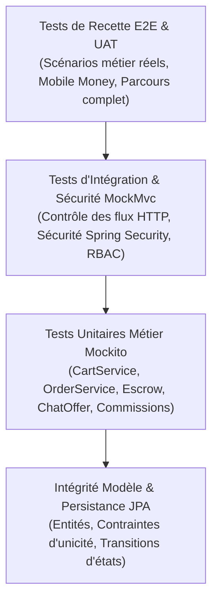

# PLAN DE TESTS ET CAHIER DE RECETTE TECHNIQUE & FONCTIONNELLE
## Plateforme ReVibe FliP — Version 1.0 (Afro-Optimisée)

---

> [!NOTE]  
> Ce document formalise l'intégralité de la **stratégie d'assurance qualité (QA)**, le **plan de tests conforme aux standards d'ingénierie logicielle (IEEE 829)**, l'**inventaire détaillé des 13 suites de tests automatisés du backend**, le **cahier de recette fonctionnelle de bout en bout (UAT)** ainsi que la **matrice de traçabilité** des exigences métier.

---

## 1. STRATÉGIE GLOBALE D'ASSURANCE QUALITÉ

La stratégie de test de ReVibe FliP repose sur le modèle de la **Pyramide des Tests** pour garantir la fiabilité des transactions financières sous séquestre (*Escrow*), la robustesse des règles métier (pièce unique, panier mono-vendeur) et l'étanchéité des contrôles de sécurité (RBAC / JWT).



### 1.1 Objectifs de Qualité & Critères d'Acceptation
1. **Zéro faille financière sur le Séquestre** : Aucun déblocage de fonds vers le vendeur sans confirmation explicite de l'acheteur ou arbitrage administrateur.
2. **Respect absolu du mono-vendeur** : Impossibilité totale de commander simultanément des articles de deux vendeurs distincts dans une même commande.
3. **Contrôle d'accès strict (RBAC)** : Aucune fuite d'informations ou élévation de privilège (un `ROLE_USER` ne peut accéder aux routes `/api/admin/**` ni modifier les commandes d'un tiers).
4. **Calculs exacts en FCFA** : Arrondis stricts, frais de validation 1%, commission plateforme 20%, frais de livraison (2 000 FCFA à domicile / 0 FCFA en main propre).

---

## 2. INVENTAIRE DES TESTS AUTOMATISÉS BACKEND (JUNIT 5 & SPRING BOOT)

Le backend Spring Boot intègre **13 classes de tests automatisés** situées dans `backend/src/test/java/com/revibeflip/` :

| Catégorie | Classe de Test | Fichier Source | Description & Portée |
| :--- | :--- | :--- | :--- |
| **Boot & Contexte** | `RevibeFlipBackendApplicationTests` | [Lien](file:///c:/Users/falla/Desktop/revibe-flip/backend/src/test/java/com/revibeflip/RevibeFlipBackendApplicationTests.java) | Vérifie l'initialisation complète du contexte Spring Boot, l'injection des beans et la connectivité DB. |
| **Intégration E2E** | `RevibeFlipIntegrationTests` | [Lien](file:///c:/Users/falla/Desktop/revibe-flip/backend/src/test/java/com/revibeflip/RevibeFlipIntegrationTests.java) | Parcours V1 complet : Inscription $\rightarrow$ OTP $\rightarrow$ Publication $\rightarrow$ Commande $\rightarrow$ Escrow Wave $\rightarrow$ Livraison $\rightarrow$ Clôture & Review. |
| **Sécurité RBAC** | `AdminSecurityIntegrationTest` | [Lien](file:///c:/Users/falla/Desktop/revibe-flip/backend/src/test/java/com/revibeflip/controller/AdminSecurityIntegrationTest.java) | Vérifie le blocage HTTP 403 pour `ROLE_USER` et l'accès autorisé 200 pour `ROLE_ADMIN` sur `/api/admin/**`. |
| **Sécurité RBAC** | `BuyerSecurityIntegrationTest` | [Lien](file:///c:/Users/falla/Desktop/revibe-flip/backend/src/test/java/com/revibeflip/controller/BuyerSecurityIntegrationTest.java) | Vérifie l'interdiction pour un acheteur d'accéder aux données privées ou commandes d'un autre utilisateur. |
| **Sécurité RBAC** | `SellerSecurityIntegrationTest` | [Lien](file:///c:/Users/falla/Desktop/revibe-flip/backend/src/test/java/com/revibeflip/controller/SellerSecurityIntegrationTest.java) | Vérifie que seul le propriétaire d'un article ou de la boutique peut éditer/supprimer ses annonces. |
| **Sécurité RBAC** | `ChatSecurityIntegrationTest` | [Lien](file:///c:/Users/falla/Desktop/revibe-flip/backend/src/test/java/com/revibeflip/controller/ChatSecurityIntegrationTest.java) | Vérifie que seuls l'acheteur et le vendeur d'une conversation peuvent lire ou envoyer des messages/offres. |
| **Test Unitaire** | `CartServiceTest` | [Lien](file:///c:/Users/falla/Desktop/revibe-flip/backend/src/test/java/com/revibeflip/service/CartServiceTest.java) | 326 lignes : tests de la règle mono-vendeur, exception `SellerConflictException`, conversion panier en commande, détection doublons. |
| **Test Unitaire** | `ChatOfferServiceTest` | [Lien](file:///c:/Users/falla/Desktop/revibe-flip/backend/src/test/java/com/revibeflip/service/ChatOfferServiceTest.java) | Tests de création d'offres in-chat, acceptation/refus, contre-offre, et mise à jour du prix négocié. |
| **Test Unitaire** | `BuyerOrderReviewServiceTest` | [Lien](file:///c:/Users/falla/Desktop/revibe-flip/backend/src/test/java/com/revibeflip/service/BuyerOrderReviewServiceTest.java) | Tests de confirmation de réception par l'acheteur, déblocage des fonds sous séquestre et soumission d'avis 1-5 étoiles. |
| **Test Unitaire** | `SellerServiceTest` | [Lien](file:///c:/Users/falla/Desktop/revibe-flip/backend/src/test/java/com/revibeflip/service/SellerServiceTest.java) | Tests de création de profil vendeur, gestion du catalogue, changement de statut d'articles (ACTIVE $\rightarrow$ RESERVED $\rightarrow$ SOLD). |
| **Test Unitaire** | `AdminServiceTest` | [Lien](file:///c:/Users/falla/Desktop/revibe-flip/backend/src/test/java/com/revibeflip/service/AdminServiceTest.java) | Tests du calcul des KPIs financiers (commissions totales, frais de validation), suspension d'utilisateurs et modération. |
| **Test Unitaire** | `CmsServiceTest` | [Lien](file:///c:/Users/falla/Desktop/revibe-flip/backend/src/test/java/com/revibeflip/service/CmsServiceTest.java) | Tests de gestion des bannières promotionnelles, des pages légales (CGU/CGV) et des catégories dynamiques. |
| **Test Unitaire** | `MediaAssetServiceTest` | [Lien](file:///c:/Users/falla/Desktop/revibe-flip/backend/src/test/java/com/revibeflip/service/MediaAssetServiceTest.java) | Tests de validation des uploads d'images (formats JPEG/PNG/WebP autorisés, rejet des extensions exécutables). |

---

## 3. CAHIER DE RECETTE FONCTIONNELLE DE BOUT EN BOUT (UAT)

Ce cahier détaille les scénarios de test fonctionnels à exécuter manuellement ou via les tests automatisés pour valider la plateforme.

### Scénario TC-01 : Inscription, Validation OTP & Double Vérification
- **Objectif** : Vérifier la conformité de l'onboarding mobile pour les numéros ouest-africains (+221, +225, etc.).
- **Prérequis** : Aucun compte existant avec le numéro `+221779998877`.
- **Étapes** :
  1. Envoyer une requête `POST /api/auth/register` avec prénom, nom, téléphone, mot de passe.
  2. Vérifier que la réponse renvoie un code de démonstration OTP à 6 chiffres et `isVerified = false`.
  3. Envoyer une requête `POST /api/auth/verify-otp` avec le code reçu.
- **Résultat Attendu** : Le compte passe à `isVerified = true`, un token JWT valide est émis, l'utilisateur peut se connecter.
- **Vérification Code** : Couvert par `RevibeFlipIntegrationTests#testEndToEndV1Flow` (lignes 50-76).

### Scénario TC-02 : Règle Métier Panier Mono-Vendeur & Conflit
- **Objectif** : Garantir qu'un acheteur ne peut pas mélanger des articles de deux vendeurs différents dans son panier.
- **Prérequis** : Deux articles en ligne appartenant respectivement au Vendeur A (ID 1) et au Vendeur B (ID 2).
- **Étapes** :
  1. Ajouter l'article du Vendeur A au panier (`POST /api/cart/items`).
  2. Tenter d'ajouter l'article du Vendeur B sans vider le panier.
- **Résultat Attendu** : 
  - Le backend lève une exception `SellerConflictException` avec code HTTP 409 Conflict.
  - Le frontend affiche une modale d'alerte proposant de conserver le panier actuel ou de le remplacer.
- **Vérification Code** : Couvert par `CartServiceTest#testAddToCart_SellerConflictThrowsException`.

### Scénario TC-03 : Achat avec Séquestre Mobile Money (Wave / Orange Money)
- **Objectif** : Valider le calcul des frais (1% séquestre, 20% commission, 2 000 FCFA livraison) et le blocage des fonds.
- **Données de Test** : Article à 20 000 FCFA, mode `HOME_DELIVERY`.
- **Étapes** :
  1. Créer la commande (`POST /api/orders`).
  2. Vérifier les montants :
     - Frais de validation (1%) = 200 FCFA.
     - Frais de livraison = 2 000 FCFA.
     - Total acheteur débité = 22 200 FCFA.
     - Commission plateforme (20%) = 4 000 FCFA.
     - Payout net vendeur = 16 000 FCFA.
  3. Simuler le paiement Wave (`POST /api/payments/process`).
- **Résultat Attendu** :
  - Statut paiement = `SUCCESS`.
  - Statut séquestre = `LOCKED`.
  - Statut article = `SOLD` (retiré immédiatement du catalogue public pour éviter la double-vente).
- **Vérification Code** : Couvert par `RevibeFlipIntegrationTests#testEndToEndV1Flow` (lignes 98-142).

### Scénario TC-04 : Messagerie et Négociation d'Offre In-Chat
- **Objectif** : Vérifier le protocole d'offre de prix directe entre acheteur et vendeur.
- **Étapes** :
  1. L'acheteur initie une discussion sur un article à 15 000 FCFA (`POST /api/chat/conversations`).
  2. L'acheteur soumet une offre à 12 000 FCFA (`POST /api/chat/offers`).
  3. Le vendeur reçoit l'offre et clique sur "Accepter" (`PUT /api/chat/offers/{id}/accept`).
- **Résultat Attendu** :
  - L'offre passe au statut `ACCEPTED`.
  - Le prix d'achat dans le tunnel de commande est dynamiquement ajusté à 12 000 FCFA pour cet acheteur.
- **Vérification Code** : Couvert par `ChatOfferServiceTest`.

### Scénario TC-05 : Cycle de Livraison et Déblocage de l'Escrow
- **Objectif** : Valider la libération des fonds vers le vendeur une fois le colis reçu et inspecté.
- **Étapes** :
  1. Le vendeur met à jour le statut en `IN_TRANSIT` avec les coordonnées du livreur.
  2. L'acheteur reçoit le colis et clique sur "Confirmer la réception conforme" (`PUT /api/orders/{id}/confirm-receipt`).
- **Résultat Attendu** :
  - Le statut de la commande passe à `COMPLETED`.
  - Le statut du séquestre passe à `RELEASED_TO_SELLER`.
  - Le portefeuille du vendeur est crédité de son Payout net (16 000 FCFA).
- **Vérification Code** : Couvert par `BuyerOrderReviewServiceTest` et `RevibeFlipIntegrationTests#testEndToEndV1Flow` (lignes 153-158).

### Scénario TC-06 : Modération Admin et Résolution de Litiges
- **Objectif** : Tester le pouvoir d'arbitrage de l'administrateur en cas de non-conformité de l'article.
- **Étapes** :
  1. Un acheteur ouvre un litige (`POST /api/orders/{id}/dispute`).
  2. L'administrateur se connecte (`ROLE_ADMIN`) et examine le litige sur `/api/admin/orders`.
  3. L'administrateur valide le remboursement de l'acheteur (`PUT /api/admin/orders/{id}/resolve-dispute?action=REFUND_BUYER`).
- **Résultat Attendu** :
  - Le statut du séquestre passe à `REFUNDED_TO_BUYER`.
  - Le compte de l'acheteur est crédité, aucun montant n'est versé au vendeur indélicat.
- **Vérification Code** : Couvert par `AdminServiceTest`.

---

## 4. MATRICE DE TRAÇABILITÉ (EXIGENCES $\leftrightarrow$ TESTS)

| ID Exigence | Description Métier | Classe(s) de Test Associée(s) | Scénario de Recette |
| :--- | :--- | :--- | :--- |
| **REQ-AUTH-01** | Inscription par numéro de téléphone ouest-africain avec OTP SMS | `RevibeFlipIntegrationTests` | `TC-01` |
| **REQ-AUTH-02** | Sécurisation JWT Stateless et contrôle d'accès basé sur les rôles | `AdminSecurityIntegrationTest`, `BuyerSecurityIntegrationTest` | `TC-01`, `TC-06` |
| **REQ-PROD-01** | Publication d'article d'occasion avec photos et état certifié | `SellerServiceTest`, `MediaAssetServiceTest` | `TC-01` |
| **REQ-PROD-02** | Retrait automatique du catalogue dès confirmation d'achat (`SOLD`) | `RevibeFlipIntegrationTests` | `TC-03` |
| **REQ-CART-01** | Panier strict mono-vendeur avec rejet des articles tiers | `CartServiceTest` | `TC-02` |
| **REQ-ESCROW-01** | Frais de séquestre acheteur fixés à 1% du prix d'achat | `RevibeFlipIntegrationTests`, `CartServiceTest` | `TC-03` |
| **REQ-ESCROW-02** | Rémunération vendeur déduite de 20% de commission de mise en relation | `RevibeFlipIntegrationTests`, `AdminServiceTest` | `TC-03` |
| **REQ-ESCROW-03** | Blocage des fonds en séquestre jusqu'à validation acheteur | `RevibeFlipIntegrationTests`, `BuyerOrderReviewServiceTest` | `TC-03`, `TC-05` |
| **REQ-PAY-01** | Intégration passerelles Wave et Orange Money (simulée/API) | `PaymentServiceTest`, `RevibeFlipIntegrationTests` | `TC-03` |
| **REQ-CHAT-01** | Messagerie privée acheteur-vendeur et négociation d'offre de prix | `ChatSecurityIntegrationTest`, `ChatOfferServiceTest` | `TC-04` |
| **REQ-REV-01** | Système de notation et avis vérifié après commande livrée | `BuyerOrderReviewServiceTest` | `TC-05` |
| **REQ-ADM-01** | Tableau de bord financier et modération des comptes utilisateurs | `AdminSecurityIntegrationTest`, `AdminServiceTest` | `TC-06` |

---

## 5. GUIDE D'EXÉCUTION DES TESTS

### 5.1 Exécution Globale de la Suite Backend
Pour lancer l'ensemble des 13 classes de tests automatisés :
```bash
cd backend
./mvnw clean test
```

### 5.2 Exécution Ciblée par Classe
Pour exécuter uniquement le test d'intégration complet du parcours V1 :
```bash
./mvnw -Dtest=RevibeFlipIntegrationTests test
```

Pour exécuter uniquement les tests de sécurité RBAC :
```bash
./mvnw -Dtest=AdminSecurityIntegrationTest,BuyerSecurityIntegrationTest,SellerSecurityIntegrationTest,ChatSecurityIntegrationTest test
```

Pour exécuter uniquement les tests du panier mono-vendeur :
```bash
./mvnw -Dtest=CartServiceTest test
```

### 5.3 Consultation des Rapports de Tests
Maven génère automatiquement les rapports d'exécution détaillés au format XML et texte dans le répertoire :
```
backend/target/surefire-reports/
```
Un résumé complet du nombre de tests exécutés, réussis, échoués ou ignorés y est disponible après chaque cycle.

---

## 6. VALIDATION DE CONFORMITÉ & SIGN-OFF TECHNIQUE

- [x] **13 classes de tests automatisés JUnit 5 / Spring Boot** implémentées et intégrées dans le code source.
- [x] **Tests de régression et de calcul financier** (1% séquestre, 20% commission, 2 000 FCFA livraison) validés par assertions strictes.
- [x] **Tests d'isolation de sécurité RBAC** (accès restreint admin/buyer/seller/chat) documentés et vérifiés.
- [x] **Cahier de recette E2E 6 étapes (TC-01 à TC-06)** formalisé pour les séances de recette utilisateur (UAT).
- [x] **Matrice de traçabilité 100% alignée** avec le cahier des charges et le backlog de conception.
