# 📋 Product Backlog & User Stories Agile (Scrum) — ReVibe FliP (V1 MVP)

> **Projet** : ReVibe FliP — Marketplace africaine de seconde main (Lancement Sénégal)  
> **Version** : 1.0 (MVP)  
> **Méthodologie** : Agile Scrum • Principes INVEST • Critères d'Acceptation BDD (Gherkin : *Étant donné / Quand / Alors*)  
> **Priorisation** : MoSCoW (*Must Have*, *Should Have*, *Could Have*, *Won't Have in V1*)  
> **Estimation** : Story Points (Suite de Fibonacci : `1, 2, 3, 5, 8, 13`)

---

## Table des Matières

1. [Synthèse du Product Backlog & Vélocité Estimée](#1-synthèse-du-product-backlog--vélocité-estimée)
2. [Définition de « Prêt » (DoR) & Définition de « Terminé » (DoD)](#2-définition-de--prêt--dor--définition-de--terminé--dod)
3. [EPIC 1 : Authentification, Vérification OTP SMS & Gestion de Compte](#3-epic-1--authentification-vérification-otp-sms--gestion-de-compte)
4. [EPIC 2 : Marketplace, Gestion des Annonces & Upload Photos](#4-epic-2--marketplace-gestion-des-annonces--upload-photos)
5. [EPIC 3 : Catalogue, Recherche par Mot-Clé & Filtres V1](#5-epic-3--catalogue-recherche-par-mot-clé--filtres-v1)
6. [EPIC 4 : Messagerie Temps Réel (WebSocket / STOMP)](#6-epic-4--messagerie-temps-réel-websocket--stomp)
7. [EPIC 5 : Commandes, Paiement Mobile (Wave / OM / Free), Frais 1% & Escrow](#7-epic-5--commandes-paiement-mobile-wave--om--free-frais-1--escrow)
8. [EPIC 6 : Livraison (Domicile & Main Propre) & Suivi des 5 Statuts](#8-epic-6--livraison-domicile--main-propre--suivi-des-5-statuts)
9. [EPIC 7 : Confirmation de Réception, Évaluations (1-5 ⭐) & Signalements](#9-epic-7--confirmation-de-réception-évaluations-1-5---signalements)
10. [EPIC 8 : Système de Notifications Multi-Événements](#10-epic-8--système-de-notifications-multi-événements)
11. [EPIC 9 : Back-Office Administrateur (Dashboard KPI & Modération)](#11-epic-9--back-office-administrateur-dashboard-kpi--modération)
12. [EPIC 10 : Exigences Non-Fonctionnelles, Sécurité & Livrables DevOps](#12-epic-10--exigences-non-fonctionnelles-sécurité--livrables-devops)
13. [Feuille de Route des Sprints (Sprint Planning V1)](#13-feuille-de-route-des-sprints-sprint-planning-v1)

---

## 1. Synthèse du Product Backlog & Vélocité Estimée

| Code Epic | Intitulé de l'Epic | Nombre de User Stories | Story Points Totaux | Priorité MoSCoW | Sprint Cible |
| :--- | :--- | :---: | :---: | :---: | :---: |
| **EPIC-01** | Authentification, Vérification OTP SMS & Profil | 6 (`US-01` à `US-06`) | **21 pts** | Must Have | Sprint 1 |
| **EPIC-02** | Marketplace, Création & Gestion des Annonces | 4 (`US-07` à `US-10`) | **18 pts** | Must Have | Sprint 1 & 2 |
| **EPIC-03** | Catalogue, Recherche, Filtres V1 & Fiche Produit | 3 (`US-11` à `US-13`) | **13 pts** | Must Have | Sprint 2 |
| **EPIC-04** | Messagerie Temps Réel (`WebSocket / STOMP`) | 3 (`US-14` à `US-16`) | **16 pts** | Must Have | Sprint 2 |
| **EPIC-05** | Commandes, Paiement Mobile (1%) & Séquestre Escrow | 4 (`US-17` à `US-20`) | **26 pts** | Must Have | Sprint 3 |
| **EPIC-06** | Livraison (2 Modes) & Suivi des 5 Statuts | 2 (`US-21` à `US-22`) | **10 pts** | Must Have | Sprint 3 |
| **EPIC-07** | Réception, Notation (1 à 5 ⭐) & Signalements | 3 (`US-23` à `US-25`) | **13 pts** | Must Have | Sprint 4 |
| **EPIC-08** | Notifications Temps Réel & SMS | 2 (`US-26` à `US-27`) | **8 pts** | Should Have | Sprint 4 |
| **EPIC-09** | Back-Office Administrateur (Dashboard & Gestion) | 6 (`US-28` à `US-33`) | **24 pts** | Must Have | Sprint 4 & 5 |
| **EPIC-10** | Sécurité API, Migrations Flyway, Tests & Docker | 3 (`US-34` à `US-36`) | **13 pts** | Must Have | Continu / Sprint 5 |
| **TOTAL V1** | **Périmètre Complet MVP ReVibe FliP** | **36 User Stories** | **162 pts** | **100 % V1** | **5 Sprints (10 sem.)** |

---

## 2. Définition de « Prêt » (DoR) & Définition de « Terminé » (DoD)

### ✅ Definition of Ready (DoR — Quand une User Story peut entrer en Sprint)
- La User Story respecte le format : *« En tant que [Rôle], je veux [Action] afin de [Bénéfice métier] »*.
- Les critères d'acceptation Gherkin (*Étant donné / Quand / Alors*) et les cas d'erreur sont rédigés.
- Les entités JPA/MySQL et les endpoints REST/STOMP associés sont identifiés dans le dossier de modélisation.
- La User Story est estimée en Story Points et ne dépasse pas 8 points.

### 🏁 Definition of Done (DoD — Quand une User Story est considérée terminée)
- Le code Backend (`Spring Boot / Java`), Frontend Web (`React / TS`) et Mobile (`React Native / TS`) est développé et typé sans erreur.
- Les validations entrantes (`Jakarta Bean Validation`) et les permissions (`ROLE_USER` / `ROLE_ADMIN`) sont appliquées.
- Les migrations SQL (`Flyway`) sont versionnées.
- L'endpoint est documenté dans `Swagger / OpenAPI`.
- Les tests unitaires et d'intégration (`JUnit / Mockito`) passent au vert.

---

## 3. EPIC 1 : Authentification, Vérification OTP SMS & Gestion de Compte

### US-01 : Inscription avec sélection du pays africain et adaptation de l'indicatif
* **Acteur** : Visiteur
* **Priorité** : `Must Have` | **Estimation** : `5 pts` | **Lien UC** : `UC-01`
* **Formulation** :
  > **En tant que** Visiteur,  
  > **Je veux** m'inscrire en renseignant mon prénom, mon nom, mon pays de résidence, mon numéro de téléphone, une adresse email facultative et mon mot de passe (avec confirmation),  
  > **Afin de** créer mon compte sur la marketplace ReVibe FliP.
* **Critères d'Acceptation (Gherkin)** :
  1. **Adaptation dynamique de l'indicatif** :
     - *Étant donné que* je suis sur l'écran d'inscription Web ou Mobile,
     - *Quand* je sélectionne « Sénégal » dans la liste des pays africains,
     - *Alors* l'indicatif téléphonique s'adapte automatiquement à `+221`.
  2. **Inscription valide et déclenchement de l'OTP** :
     - *Étant donné que* je saisis un numéro `+22177...` non inscrit, mon nom/prénom et deux mots de passe identiques,
     - *Quand* je valide le formulaire,
     - *Alors* mon mot de passe est haché (`BCrypt`), mon compte est créé au statut `PENDING_OTP`, un code OTP m'est envoyé par SMS et je suis redirigé vers l'écran de vérification OTP (`HTTP 201`).
  3. **Rejet en cas de doublon de numéro** :
     - *Étant donné qu'*un compte existe déjà avec ce numéro de téléphone,
     - *Quand* je tente de m'inscrire avec ce même numéro,
     - *Alors* le système refuse l'inscription (`HTTP 409 Conflict`) et affiche un message explicite.

---

### US-02 : Validation du compte par code OTP SMS
* **Acteur** : Visiteur inscrit (`PENDING_OTP`)
* **Priorité** : `Must Have` | **Estimation** : `5 pts` | **Lien UC** : `UC-01`
* **Formulation** :
  > **En tant qu'** Utilisateur venant de s'inscrire,  
  > **Je veux** saisir le code OTP reçu par SMS,  
  > **Afin de** certifier mon numéro de téléphone et activer définitivement mon compte.
* **Critères d'Acceptation (Gherkin)** :
  1. **Code OTP valide** :
     - *Étant donné que* j'ai reçu un code OTP de 6 chiffres non expiré (moins de 5 minutes),
     - *Quand* je saisis ce code et valide,
     - *Alors* mon compte passe au statut `ACTIVE` (`phone_verified = true`), je reçois mon token `JWT` et j'accède à la marketplace (`HTTP 200`).
  2. **Code OTP erroné ou expiré** :
     - *Étant donné que* je saisis un code incorrect ou expiré,
     - *Quand* je valide,
     - *Alors* l'activation est refusée (`HTTP 400`) et au bout de 3 échecs consécutifs le code est bloqué (`HTTP 429`), m'obligeant à cliquer sur « Renvoyer un code OTP ».

---

### US-03 : Connexion sécurisée (JWT) et Déconnexion
* **Acteur** : Utilisateur (`ROLE_USER` / `ROLE_ADMIN`)
* **Priorité** : `Must Have` | **Estimation** : `3 pts` | **Lien UC** : `UC-02`
* **Formulation** :
  > **En tant qu'** Utilisateur inscrit et activé,  
  > **Je veux** me connecter avec mes identifiants et pouvoir me déconnecter à tout moment,  
  > **Afin d'** accéder de manière sécurisée à mon espace personnel sur Web et Mobile.
* **Critères d'Acceptation (Gherkin)** :
  1. **Connexion réussie** :
     - *Étant donné que* mon compte est `ACTIVE`,
     - *Quand* je saisis mon téléphone et mon mot de passe exacts,
     - *Alors* le backend retourne un token `JWT` signé contenant mon rôle (`ROLE_USER` ou `ROLE_ADMIN`).
  2. **Blocage d'un compte suspendu** :
     - *Étant donné que* mon compte a été suspendu par l'administrateur (`SUSPENDED`),
     - *Quand* je tente de me connecter,
     - *Alors* l'accès m'est refusé (`HTTP 403 Forbidden`) avec la mention de suspension.
  3. **Déconnexion** :
     - *Quand* je clique sur « Se déconnecter »,
     - *Alors* mon token `JWT` local est purgé et ma connexion WebSocket STOMP est fermée.

---

### US-04 : Réinitialisation de mot de passe oublié par OTP SMS
* **Acteur** : Utilisateur
* **Priorité** : `Must Have` | **Estimation** : `3 pts` | **Lien UC** : `UC-02`
* **Formulation** :
  > **En tant qu'** Utilisateur ayant oublié son mot de passe,  
  > **Je veux** recevoir un code OTP par SMS sur mon numéro vérifié pour définir un nouveau mot de passe,  
  > **Afin de** récupérer l'accès à mon compte en toute autonomie.
* **Critères d'Acceptation (Gherkin)** :
  1. *Étant donné que* je saisis mon numéro de téléphone inscrit sur l'écran « Mot de passe oublié »,
  2. *Quand* je valide le code OTP reçu par SMS et mon nouveau mot de passe (avec confirmation),
  3. *Alors* mon mot de passe est mis à jour et haché avec `BCrypt` en base (`HTTP 200`).

---

### US-05 : Modification des informations personnelles, photo de profil et adresses
* **Acteur** : Utilisateur Authentifié (`ROLE_USER`)
* **Priorité** : `Must Have` | **Estimation** : `3 pts` | **Lien UC** : `UC-03`
* **Formulation** :
  > **En tant qu'** Utilisateur connecté,  
  > **Je veux** modifier mon prénom, mon nom, mon email, ma photo de profil et mes adresses de livraison,  
  > **Afin de** maintenir mes coordonnées exactes pour mes futures transactions.
* **Critères d'Acceptation (Gherkin)** :
  1. *Quand* je téléverse une nouvelle photo de profil (`JPG/PNG/WEBP <= 5 Mo`) et modifie mes informations,
  2. *Alors* la photo est stockée sur le Cloud Storage et mon profil est immédiatement mis à jour.

---

### US-06 : Consultation de son tableau de bord personnel (Annonces, Commandes, Évaluations)
* **Acteur** : Utilisateur Authentifié (`ROLE_USER`)
* **Priorité** : `Must Have` | **Estimation** : `2 pts` | **Lien UC** : `UC-03`
* **Formulation** :
  > **En tant qu'** Utilisateur connecté,  
  > **Je veux** consulter depuis mon profil la liste de mes annonces, mes commandes (achats/ventes) et mes évaluations reçues,  
  > **Afin de** suivre toute mon activité sur ReVibe FliP au même endroit.
* **Critères d'Acceptation (Gherkin)** :
  1. *Quand* j'ouvre mon profil,
  2. *Alors* je vois ma note moyenne sur 5, mon nombre total d'avis, ainsi que l'historique paginé de mes annonces et commandes.

---

## 4. EPIC 2 : Marketplace, Gestion des Annonces & Upload Photos

### US-07 : Création et publication d'une annonce avec galerie photos
* **Acteur** : Vendeur (`ROLE_USER`)
* **Priorité** : `Must Have` | **Estimation** : `8 pts` | **Lien UC** : `UC-04`
* **Formulation** :
  > **En tant que** Vendeur,  
  > **Je veux** créer une annonce contenant une ou plusieurs photos, un titre, une catégorie, un prix, un état, une description ainsi que la taille, la marque, la couleur et la localisation,  
  > **Afin de** mettre mon article de seconde main en vente sur la marketplace.
* **Critères d'Acceptation (Gherkin)** :
  1. **Publication complète** :
     - *Étant donné que* je suis connecté,
     - *Quand* je joins au moins 1 photo, renseigne le titre, la catégorie, le prix (> 0 FCFA), l'état, la description et les infos complémentaires, puis clique sur « Publier »,
     - *Alors* les photos sont uploadées sur le Cloud Storage, l'annonce est créée au statut `ACTIVE` (`HTTP 201`) et devient immédiatement visible dans le catalogue.
  2. **Sauvegarde en brouillon (`DRAFT`)** :
     - *Quand* je clique sur « Enregistrer en brouillon »,
     - *Alors* l'annonce est sauvegardée avec le statut `DRAFT` et n'est visible que dans mon espace vendeur.
  3. **Validation entrante stricte** :
     - *Quand* je tente de publier une annonce sans photo ou sans prix valide,
     - *Alors* le système rejette la requête (`HTTP 400 Bad Request`) avec la liste des champs manquants.

---

### US-08 : Modification d'une annonce existante par le vendeur
* **Acteur** : Vendeur (`ROLE_USER`)
* **Priorité** : `Must Have` | **Estimation** : `3 pts` | **Lien UC** : `UC-05`
* **Formulation** :
  > **En tant que** Vendeur propriétaire d'une annonce,  
  > **Je veux** modifier les informations, le prix ou les photos de mon annonce,  
  > **Afin de** corriger une erreur ou ajuster mon prix pour vendre plus vite.
* **Critères d'Acceptation (Gherkin)** :
  1. *Étant donné que* je suis le propriétaire (`seller_id`) d'une annonce au statut `DRAFT`, `ACTIVE` ou `INACTIVE`,
  2. *Quand* je modifie ses champs et valide,
  3. *Alors* les modifications sont enregistrées (`HTTP 200`).
  4. *Si* un autre utilisateur tente de modifier mon annonce ou si l'annonce est déjà `SOLD` / `RESERVED`, *alors* l'action est refusée (`HTTP 403` / `HTTP 409`).

---

### US-09 : Désactivation et réactivation d'une annonce (`ACTIVE` ↔ `INACTIVE`)
* **Acteur** : Vendeur (`ROLE_USER`)
* **Priorité** : `Must Have` | **Estimation** : `3 pts` | **Lien UC** : `UC-05`
* **Formulation** :
  > **En tant que** Vendeur,  
  > **Je veux** pouvoir désactiver temporairement mon annonce puis la réactiver plus tard,  
  > **Afin de** masquer un article momentanément indisponible sans perdre ma fiche produit.
* **Critères d'Acceptation (Gherkin)** :
  1. *Quand* je désactive une annonce `ACTIVE`, son statut passe à `INACTIVE` et elle disparaît des résultats de recherche du catalogue.
  2. *Quand* je réactive une annonce `INACTIVE`, son statut repasse à `ACTIVE` et elle réapparaît dans le catalogue.

---

### US-10 : Suppression d'une annonce par le vendeur
* **Acteur** : Vendeur (`ROLE_USER`)
* **Priorité** : `Must Have` | **Estimation** : `4 pts` | **Lien UC** : `UC-05`
* **Formulation** :
  > **En tant que** Vendeur,  
  > **Je veux** supprimer définitivement une annonce qui n'a fait l'objet d'aucune commande,  
  > **Afin de** retirer un article que je ne souhaite plus vendre.
* **Critères d'Acceptation (Gherkin)** :
  1. *Étant donné que* mon annonce n'est liée à aucune commande en cours ou terminée,
  2. *Quand* je confirme sa suppression,
  3. *Alors* l'annonce est retirée définitivement du catalogue et de ma liste active (`HTTP 204`).

---

## 5. EPIC 3 : Catalogue, Recherche par Mot-Clé & Filtres V1

### US-11 : Consultation de la grille du catalogue d'articles disponibles
* **Acteur** : Acheteur / Visiteur
* **Priorité** : `Must Have` | **Estimation** : `3 pts` | **Lien UC** : `UC-06`
* **Formulation** :
  > **En tant qu'** Acheteur ou Visiteur,  
  > **Je veux** parcourir la page catalogue affichant les articles disponibles avec leur photo, titre, prix, état, localisation et vendeur,  
  > **Afin de** découvrir les offres de seconde main publiées sur ReVibe FliP.
* **Critères d'Acceptation (Gherkin)** :
  1. *Quand* j'ouvre la page catalogue sur Web ou Mobile,
  2. *Alors* le système affiche de manière paginée uniquement les articles au statut `ACTIVE`, avec pour chaque carte : photo principale, titre, prix en FCFA, état, ville et nom du vendeur.

---

### US-12 : Recherche par mot-clé et application des Filtres V1
* **Acteur** : Acheteur / Visiteur
* **Priorité** : `Must Have` | **Estimation** : `5 pts` | **Lien UC** : `UC-06`
* **Formulation** :
  > **En tant qu'** Acheteur,  
  > **Je veux** rechercher un article par mot-clé et filtrer les résultats par catégorie, prix minimum/maximum, taille, état et pays/localisation du vendeur,  
  > **Afin de** trouver rapidement l'article exact qui correspond à mon besoin et à mon budget.
* **Critères d'Acceptation (Gherkin)** :
  1. **Combinaison Recherche + Filtres V1** :
     - *Quand* je saisis un mot-clé (ex: « Nike ») et sélectionne une catégorie (« Chaussures »), une taille (« 42 »), un état (« Comme neuf »), un prix entre `5 000` et `25 000 FCFA` et une localisation (« Dakar, Sénégal »),
     - *Alors* seuls les articles `ACTIVE` respectant **tous** ces critères sont retournés.

---

### US-13 : Consultation de la fiche détail produit et de la réputation vendeur
* **Acteur** : Acheteur / Visiteur
* **Priorité** : `Must Have` | **Estimation** : `5 pts` | **Lien UC** : `UC-07`
* **Formulation** :
  > **En tant qu'** Acheteur,  
  > **Je veux** consulter la fiche détail complète d'un produit (galerie de photos, titre, prix, description, état, taille, catégorie, localisation, infos vendeur, note moyenne et nombre d'évaluations),  
  > **Afin d'** évaluer la qualité de l'article et la fiabilité du vendeur avant de le contacter ou d'acheter.
* **Critères d'Acceptation (Gherkin)** :
  1. *Quand* je clique sur un article du catalogue,
  2. *Alors* je visualise toute la galerie photos, les caractéristiques complètes, la note moyenne du vendeur (ex: `4.8 / 5` sur `12 avis`) ainsi que les deux boutons d'actions principales : **« Contacter le vendeur »** et **« Acheter »**.

---

## 6. EPIC 4 : Messagerie Temps Réel (WebSocket / STOMP)

### US-14 : Ouverture d'une conversation depuis une annonce et liste des conversations
* **Acteur** : Acheteur & Vendeur (`ROLE_USER`)
* **Priorité** : `Must Have` | **Estimation** : `5 pts` | **Lien UC** : `UC-08`
* **Formulation** :
  > **En tant qu'** Acheteur,  
  > **Je veux** ouvrir une conversation avec un vendeur directement depuis la fiche de son annonce et retrouver la liste de toutes mes conversations,  
  > **Afin de** poser des questions sur l'article ou convenir d'une remise en main propre.
* **Critères d'Acceptation (Gherkin)** :
  1. *Étant donné que* je suis sur la fiche d'un produit,
  2. *Quand* je clique sur « Contacter le vendeur »,
  3. *Alors* le système ouvre la conversation existante pour ce produit ou en crée une nouvelle, et affiche l'en-tête rappelant le produit concerné.

---

### US-15 : Envoi et réception de messages texte en temps réel (`WebSocket / STOMP`)
* **Acteur** : Acheteur & Vendeur (`ROLE_USER`)
* **Priorité** : `Must Have` | **Estimation** : `8 pts` | **Lien UC** : `UC-08`
* **Formulation** :
  > **En tant qu'** Acheteur ou Vendeur,  
  > **Je veux** envoyer et recevoir des messages texte instantanément avec leur date et heure via `WebSocket / STOMP`,  
  > **Afin de** communiquer de manière fluide sans avoir à recharger la page.
* **Critères d'Acceptation (Gherkin)** :
  1. *Étant donné que* j'ai une conversation ouverte,
  2. *Quand* j'envoie un message texte,
  3. *Alors* le message est persisté en base MySQL avec sa date/heure exacte et s'affiche en temps réel chez mon interlocuteur via le broker `STOMP`.

---

### US-16 : Gestion du statut Lu / Non-lu et compteur de nouveaux messages
* **Acteur** : Acheteur & Vendeur (`ROLE_USER`)
* **Priorité** : `Must Have` | **Estimation** : `3 pts` | **Lien UC** : `UC-08`
* **Formulation** :
  > **En tant qu'** Utilisateur,  
  > **Je veux** voir le statut `lu / non lu` de mes messages ainsi qu'une notification de nouveau message,  
  > **Afin de** savoir immédiatement quand mon interlocuteur a répondu ou pris connaissance de mon message.
* **Critères d'Acceptation (Gherkin)** :
  1. *Quand* je reçois un message alors que la conversation est fermée, un badge « Non lu » et une notification `NEW_MESSAGE` s'affichent.
  2. *Quand* j'ouvre la conversation, les messages passent automatiquement au statut `is_read = true` et l'expéditeur voit l'indicateur « Lu ».

---

## 7. EPIC 5 : Commandes, Paiement Mobile (Wave / OM / Free), Frais 1% & Escrow

### US-17 : Passage de commande, choix du mode de livraison et calcul du frais de 1 %
* **Acteur** : Acheteur (`ROLE_USER`)
* **Priorité** : `Must Have` | **Estimation** : `8 pts` | **Lien UC** : `UC-09`
* **Formulation** :
  > **En tant qu'** Acheteur,  
  > **Je veux** passer une commande sur un produit, choisir mon mode de livraison (Livraison à domicile ou Remise en main propre) et visualiser un récapitulatif distinguant le prix du produit, les frais de validation de 1 % et les frais de livraison,  
  > **Afin de** connaître en toute transparence le montant exact à payer avant de valider mon achat.
* **Critères d'Acceptation (Gherkin)** :
  1. **Calcul financier transparent (Section 10)** :
     - *Étant donné qu'*un article coûte `10 000 FCFA` et que les frais de livraison à domicile sont de `1 500 FCFA`,
     - *Quand* j'affiche le récapitulatif de commande,
     - *Alors* le système affiche distinctement :
       - Prix du produit : `10 000 FCFA`
       - Frais de validation (1 %) : `100 FCFA`
       - Frais de livraison : `1 500 FCFA`
       - **Montant Total** : `11 600 FCFA`.
  2. **Création de la commande et réservation de l'article** :
     - *Quand* je valide le récapitulatif,
     - *Alors* une commande dotée d'un numéro unique est créée au statut `PENDING_PAYMENT` et l'annonce passe en `RESERVED` pour empêcher un double achat.

---

### US-18 : Paiement Mobile Money réel (Wave, Orange Money, Free Money)
* **Acteur** : Acheteur (`ROLE_USER`)
* **Priorité** : `Must Have` | **Estimation** : `8 pts` | **Lien UC** : `UC-10`
* **Formulation** :
  > **En tant qu'** Acheteur,  
  > **Je veux** régler ma commande via un moyen de paiement mobile adapté au Sénégal (**Wave**, **Orange Money** ou **Free Money**),  
  > **Afin de** confirmer ma commande avec le moyen de paiement que j'utilise au quotidien.
* **Critères d'Acceptation (Gherkin)** :
  1. **Confirmation de paiement via Webhook sécurisé** :
     - *Étant donné que* j'ai initié un paiement Wave, Orange Money ou Free Money pour ma commande,
     - *Quand* je valide le paiement sur mon mobile et que le prestataire envoie le Webhook signé confirmant le succès,
     - *Alors* le paiement passe à `AUTHORIZED_ESCROW`, la commande passe à `PAID` (Commande confirmée), et le vendeur ainsi que moi-même recevons une notification de confirmation.
  2. **Gestion d'échec de paiement** :
     - *Quand* le paiement échoue ou est annulé,
     - *Alors* le paiement passe à `FAILED`, la commande à `CANCELLED` et l'annonce redevient `ACTIVE` dans le catalogue.

---

### US-19 : Gestion du Séquestre (Escrow) — Blocage et libération des fonds
* **Acteur** : Système / Acheteur / Vendeur
* **Priorité** : `Must Have` | **Estimation** : `5 pts` | **Lien UC** : `UC-10`, `UC-12`
* **Formulation** :
  > **En tant qu'** Acheteur et Vendeur,  
  > **Nous voulons** que les fonds payés soient sécurisés en séquestre (Escrow) pendant la livraison et ne soient libérés au vendeur qu'après confirmation de réception,  
  > **Afin de** protéger l'acheteur contre la non-livraison et garantir au vendeur que l'argent est bien disponible.
* **Critères d'Acceptation (Gherkin)** :
  1. *Tant que* l'acheteur n'a pas confirmé la réception (`Order.status != COMPLETED`), le paiement reste marqué `is_escrow_held = true` (`AUTHORIZED_ESCROW`).
  2. *Dès que* l'acheteur confirme la réception, le système déclenche la libération du `item_price` au vendeur, conserve le `validation_fee` (1 %) et passe le paiement à `RELEASED_TO_SELLER`.

---

### US-20 : Consultation de l'historique des transactions par le vendeur et l'acheteur
* **Acteur** : Vendeur & Acheteur (`ROLE_USER`)
* **Priorité** : `Must Have` | **Estimation** : `5 pts` | **Lien UC** : `UC-03`, `UC-09`
* **Formulation** :
  > **En tant que** Vendeur ou Acheteur,  
  > **Je veux** consulter la liste et le détail de mes commandes et transactions financières (montant, frais, statut du paiement, dates),  
  > **Afin de** suivre mes ventes, mes revenus encaissés et mes achats.
* **Critères d'Acceptation (Gherkin)** :
  1. *Quand* j'ouvre « Mes Transactions / Mes Commandes »,
  2. *Alors* je visualise chaque commande avec son numéro unique, le produit, l'acheteur/vendeur, le détail des montants, le statut de paiement et les dates.

---

## 8. EPIC 6 : Livraison (Domicile & Main Propre) & Suivi des 5 Statuts

### US-21 : Préparation et remise de l'article pour livraison par le vendeur
* **Acteur** : Vendeur (`ROLE_USER`)
* **Priorité** : `Must Have` | **Estimation** : `5 pts` | **Lien UC** : `UC-11`
* **Formulation** :
  > **En tant que** Vendeur ayant reçu une commande payée,  
  > **Je veux** préparer l'article et faire évoluer son statut de prise en charge et d'expédition,  
  > **Afin d'** informer l'acheteur que son article est en route.
* **Critères d'Acceptation (Gherkin)** :
  1. *Étant donné qu'*une commande est au statut `PAID`,
  2. *Quand* je remets l'article pour livraison,
  3. *Alors* le statut de livraison passe de `PENDING` à `PICKED_UP`, puis évolue vers `IN_TRANSIT`, `OUT_FOR_DELIVERY` et `DELIVERED`, en envoyant une notification à l'acheteur à chaque étape.

---

### US-22 : Suivi en temps réel des 5 statuts de livraison par l'acheteur
* **Acteur** : Acheteur (`ROLE_USER`)
* **Priorité** : `Must Have` | **Estimation** : `5 pts` | **Lien UC** : `UC-11`
* **Formulation** :
  > **En tant qu'** Acheteur,  
  > **Je veux** suivre l'avancement de ma livraison à travers les 5 statuts officiels (`PENDING` → `PICKED_UP` → `IN_TRANSIT` → `OUT_FOR_DELIVERY` → `DELIVERED`),  
  > **Afin de** savoir exactement quand mon article me sera remis.
* **Critères d'Acceptation (Gherkin)** :
  1. *Quand* je consulte les détails de ma commande sur Web ou Mobile,
  2. *Alors* une chronologie visuelle (Stepper) m'affiche l'étape actuelle parmi les 5 statuts normalisés avec l'horodatage de chaque étape franchie.

---

## 9. EPIC 7 : Confirmation de Réception, Évaluations (1-5 ⭐) & Signalements

### US-23 : Confirmation de réception de l'article par l'acheteur
* **Acteur** : Acheteur (`ROLE_USER`)
* **Priorité** : `Must Have` | **Estimation** : `3 pts` | **Lien UC** : `UC-12`
* **Formulation** :
  > **En tant qu'** Acheteur ayant reçu son article,  
  > **Je veux** confirmer officiellement la réception dans l'application,  
  > **Afin de** clôturer la commande, débloquer le paiement au vendeur et pouvoir laisser un avis.
* **Critères d'Acceptation (Gherkin)** :
  1. *Étant donné que* ma commande est livrée (`DELIVERED`),
  2. *Quand* je clique sur « Confirmer la réception »,
  3. *Alors* la commande passe à `COMPLETED`, l'annonce passe à `SOLD`, le séquestre est libéré au vendeur et le formulaire d'évaluation m'est proposé.

---

### US-24 : Attribution d'une note (1 à 5) et d'un commentaire avec calcul de la moyenne vendeur
* **Acteur** : Acheteur (`ROLE_USER`)
* **Priorité** : `Must Have` | **Estimation** : `5 pts` | **Lien UC** : `UC-13`
* **Formulation** :
  > **En tant qu'** Acheteur ayant terminé une transaction,  
  > **Je veux** attribuer une note de 1 à 5 étoiles et laisser un commentaire au vendeur,  
  > **Afin de** partager mon expérience et mettre à jour la note moyenne publique du vendeur.
* **Critères d'Acceptation (Gherkin)** :
  1. **Dépôt d'avis et recalcul de la moyenne** :
     - *Étant donné que* ma commande est `COMPLETED` et que je n'ai pas encore laissé d'avis,
     - *Quand* je soumets une note de `5/5` et un commentaire,
     - *Alors* l'avis est enregistré, la note moyenne et le compteur d'avis du vendeur sont recalculés automatiquement, et le vendeur reçoit une notification `NEW_REVIEW`.
  2. **Unicité de l'avis par commande** :
     - *Quand* je tente de noter une seconde fois la même commande,
     - *Alors* le système refuse (`HTTP 409 Conflict`).

---

### US-25 : Signalement d'un article ou d'un utilisateur selon les 6 motifs V1
* **Acteur** : Utilisateur Authentifié (`ROLE_USER`)
* **Priorité** : `Must Have` | **Estimation** : `5 pts` | **Lien UC** : `UC-14`
* **Formulation** :
  > **En tant qu'** Utilisateur (Acheteur ou Vendeur),  
  > **Je veux** pouvoir signaler une annonce ou un utilisateur en choisissant parmi les 6 motifs prévus (*Annonce trompeuse, Contrefaçon présumée, Arnaque, Faux profil, Comportement abusif, Autre motif*),  
  > **Afin d'** alerter l'administrateur et protéger la communauté.
* **Critères d'Acceptation (Gherkin)** :
  1. *Quand* je soumets un signalement avec l'un des 6 motifs et une description,
  2. *Alors* le signalement est enregistré en base au statut `PENDING` et transmis instantanément au Back-Office Administrateur.

---

## 10. EPIC 8 : Système de Notifications Multi-Événements

### US-26 : Déclenchement automatique des 7 types de notifications V1
* **Acteur** : Système / Utilisateur (`ROLE_USER`)
* **Priorité** : `Should Have` | **Estimation** : `5 pts` | **Lien UC** : Transverse (`Section 14`)
* **Formulation** :
  > **En tant qu'** Utilisateur,  
  > **Je veux** recevoir des notifications pour les 7 événements clés de la V1 (*OTP, nouveau message, commande créée, paiement confirmé, évolution de la livraison, commande livrée, nouvelle évaluation*),  
  > **Afin d'** être alerté en temps réel de chaque étape importante de mes transactions.
* **Critères d'Acceptation (Gherkin)** :
  1. *Pour chacun* des 7 événements listés en Section 14 du cahier des charges,
  2. *Quand* l'événement se produit dans le backend,
  3. *Alors* une notification est créée et poussée à l'utilisateur concerné.

---

### US-27 : Centre de notifications In-App et marquage comme lu
* **Acteur** : Utilisateur (`ROLE_USER`)
* **Priorité** : `Should Have` | **Estimation** : `3 pts` | **Lien UC** : Transverse (`Section 14`)
* **Formulation** :
  > **En tant qu'** Utilisateur connecté,  
  > **Je veux** consulter la liste de mes notifications et les marquer comme lues,  
  > **Afin de** suivre mes alertes et accéder directement à la commande ou au message concerné.
* **Critères d'Acceptation (Gherkin)** :
  1. *Quand* je clique sur l'icône de cloche de notifications, je vois mes alertes récentes et le compteur de non-lues se remet à zéro à la lecture.

---

## 11. EPIC 9 : Back-Office Administrateur (Dashboard KPI & Modération)

### US-28 : Consultation du Dashboard Administrateur (6 KPI globaux)
* **Acteur** : Administrateur (`ROLE_ADMIN`)
* **Priorité** : `Must Have` | **Estimation** : `5 pts` | **Lien UC** : `UC-15`
* **Formulation** :
  > **En tant qu'** Administrateur,  
  > **Je veux** visualiser sur mon Dashboard le nombre d'utilisateurs, le nombre d'annonces, le nombre de commandes, le nombre de transactions, le total des commissions (1 %) et les signalements en attente,  
  > **Afin de** piloter l'activité globale de ReVibe FliP en un coup d'œil.
* **Critères d'Acceptation (Gherkin)** :
  1. *Étant donné que* je suis connecté avec le rôle `ROLE_ADMIN`,
  2. *Quand* j'ouvre le Dashboard du Back-Office,
  3. *Alors* les 6 indicateurs exacts s'affichent en temps réel. Si un simple `ROLE_USER` tente d'accéder à l'URL `/api/v1/admin/**`, il reçoit `HTTP 403 Forbidden`.

---

### US-29 : Gestion des utilisateurs (Recherche, Consultation, Suspension, Réactivation)
* **Acteur** : Administrateur (`ROLE_ADMIN`)
* **Priorité** : `Must Have` | **Estimation** : `5 pts` | **Lien UC** : `UC-16`
* **Formulation** :
  > **En tant qu'** Administrateur,  
  > **Je veux** rechercher, consulter, suspendre et réactiver des utilisateurs,  
  > **Afin de** bloquer les comptes frauduleux ou rétablir un utilisateur après vérification.
* **Critères d'Acceptation (Gherkin)** :
  1. *Quand* je suspends un utilisateur depuis le Back-Office, son statut passe à `SUSPENDED`, il ne peut plus se connecter et ses annonces actives sont masquées.
  2. *Quand* je le réactive, son statut repasse à `ACTIVE`.

---

### US-30 : Modération des annonces par l'administrateur (Recherche, Désactivation, Suppression)
* **Acteur** : Administrateur (`ROLE_ADMIN`)
* **Priorité** : `Must Have` | **Estimation** : `3 pts` | **Lien UC** : `UC-17`
* **Formulation** :
  > **En tant qu'** Administrateur,  
  > **Je veux** rechercher, consulter, désactiver ou supprimer n'importe quelle annonce de la plateforme,  
  > **Afin de** retirer immédiatement les articles interdits, trompeurs ou contrefaits.
* **Critères d'Acceptation (Gherkin)** :
  1. *Quand* je désactive ou supprime une annonce depuis le Back-Office, elle est immédiatement retirée du catalogue public.

---

### US-31 : Gestion complète des catégories (Création, Modification, Suppression)
* **Acteur** : Administrateur (`ROLE_ADMIN`)
* **Priorité** : `Must Have` | **Estimation** : `3 pts` | **Lien UC** : `UC-17`
* **Formulation** :
  > **En tant qu'** Administrateur,  
  > **Je veux** créer, modifier et supprimer des catégories de produits,  
  > **Afin d'** organiser et faire évoluer la nomenclature du catalogue (Vêtements, Chaussures, Accessoires...).
* **Critères d'Acceptation (Gherkin)** :
  1. *Quand* je crée ou modifie une catégorie, elle devient immédiatement sélectionnable par les vendeurs et dans les filtres du catalogue.

---

### US-32 : Consultation et suivi des commandes et des transactions de paiement
* **Acteur** : Administrateur (`ROLE_ADMIN`)
* **Priorité** : `Must Have` | **Estimation** : `3 pts` | **Lien UC** : `UC-18`
* **Formulation** :
  > **En tant qu'** Administrateur,  
  > **Je veux** consulter la liste complète des commandes, leur statut de livraison et le journal des transactions de paiement Mobile Money,  
  > **Afin de** contrôler les flux financiers, les séquestres (Escrow) et les commissions de 1 %.
* **Critères d'Acceptation (Gherkin)** :
  1. *Quand* j'ouvre les menus « Commandes » et « Paiements » du Back-Office, je peux filtrer par statut et inspecter chaque transaction (`item_price`, `validation_fee`, `delivery_fee`, `provider`, `status`).

---

### US-33 : Traitement, arbitrage et clôture des signalements et litiges
* **Acteur** : Administrateur (`ROLE_ADMIN`)
* **Priorité** : `Must Have` | **Estimation** : `5 pts` | **Lien UC** : `UC-18`
* **Formulation** :
  > **En tant qu'** Administrateur,  
  > **Je veux** consulter les signalements en attente, les traiter (appliquer une sanction ou arbitrer un litige de commande) et les clôturer,  
  > **Afin de** résoudre les conflits entre acheteurs et vendeurs de manière traçable.
* **Critères d'Acceptation (Gherkin)** :
  1. *Quand* je traite un signalement `PENDING`, je peux saisir une note de résolution, éventuellement désactiver l'annonce ou suspendre l'utilisateur ciblé, et clôturer le ticket à l'état `RESOLVED` ou `REJECTED`.

---

## 12. EPIC 10 : Exigences Non-Fonctionnelles, Sécurité & Livrables DevOps

### US-34 : Sécurisation des API Spring Security + JWT, RBAC et Gestion centralisée des erreurs
* **Acteur** : Équipe d'Ingénierie / Architecte
* **Priorité** : `Must Have` | **Estimation** : `5 pts` | **Référence CDC** : `Section 16`
* **Formulation** :
  > **En tant qu'** Architecte Sécurité,  
  > **Je veux** protéger tous les endpoints REST et WebSocket avec `Spring Security + JWT`, appliquer le contrôle strict des rôles (`ROLE_USER`, `ROLE_ADMIN`), valider toutes les entrées (`Jakarta Bean Validation`), journaliser les événements critiques et centraliser la gestion des erreurs,  
  > **Afin de** garantir la robustesse et la sécurité de la plateforme en production.
* **Critères d'Acceptation (Gherkin)** :
  1. Toute requête invalide ou non autorisée renvoie une structure JSON d'erreur normalisée (`@RestControllerAdvice`) sans jamais exposer de trace technique interne ni de mot de passe.

---

### US-35 : Versionnement du schéma MySQL avec Flyway et Documentation OpenAPI / Swagger
* **Acteur** : Développeur Backend / Frontend
* **Priorité** : `Must Have` | **Estimation** : `3 pts` | **Référence CDC** : `Sections 17, 18, 23`
* **Formulation** :
  > **En tant que** Développeur,  
  > **Je veux** que les 14 entités MySQL soient gérées par des migrations `Flyway` et que l'intégralité de l'API REST soit documentée sous `Swagger / OpenAPI`,  
  > **Afin de** garantir la reproductibilité de la base de données et faciliter l'intégration Front/Mobile.
* **Critères d'Acceptation (Gherkin)** :
  1. Au démarrage de Spring Boot, `Flyway` exécute proprement les scripts SQL versionnés et l'interface `/swagger-ui.html` expose tous les endpoints de la V1.

---

### US-36 : Conteneurisation Docker, Tests Unitaires/Intégration et Documentation de livraison
* **Acteur** : Équipe DevOps / QA
* **Priorité** : `Must Have` | **Estimation** : `5 pts` | **Référence CDC** : `Sections 22, 23`
* **Formulation** :
  > **En tant que** Chef de Projet,  
  > **Je veux** disposer des tests unitaires et d'intégration (`JUnit / Mockito`), d'une configuration `Docker / docker-compose`, d'un fichier `.env.example` et de la documentation d'installation et des intégrations externes (OTP, paiement, stockage images),  
  > **Afin de** valider tous les critères d'acceptation de la Section 22 et livrer un MVP prêt pour la démonstration et la mise en production.
* **Critères d'Acceptation (Gherkin)** :
  1. Le parcours principal (Inscription → OTP → Publication annonce → Recherche → Messagerie → Commande → Paiement → Livraison → Réception → Avis + Supervision Admin) fonctionne de bout en bout sans intervention technique.

---

## 13. Feuille de Route des Sprints (Sprint Planning V1)

```mermaid
%%{init: {'theme': 'base', 'themeVariables': { 'primaryColor': '#f3e8ff', 'primaryTextColor': '#2e1065', 'primaryBorderColor': '#7c3aed', 'lineColor': '#6d28d9', 'secondaryColor': '#ede9fe', 'tertiaryColor': '#faf5ff' }}}%%
flowchart LR
    subgraph S1["🗓️ SPRINT 1 (Sem. 1-2)\nFondations & Identité (31 pts)"]
        S1_1["US-34 & US-35 : Socle Spring Boot, MySQL Flyway, JWT, Swagger"]
        S1_2["US-01 à US-06 : Inscription, OTP SMS (+221), Login, Profil & Adresses"]
    end

    subgraph S2["🗓️ SPRINT 2 (Sem. 3-4)\nCatalogue & Messagerie (47 pts)"]
        S2_1["US-07 à US-10 : Création & Gestion Annonces + Upload Cloud"]
        S2_2["US-11 à US-13 : Catalogue, Recherche & Filtres V1, Fiche Produit"]
        S2_3["US-14 à US-16 : Messagerie Temps Réel WebSocket / STOMP"]
    end

    subgraph S3["🗓️ SPRINT 3 (Sem. 5-6)\nCommandes, Paiement & Livraison (36 pts)"]
        S3_1["US-17 à US-20 : Commande, Calcul 1%, Paiement Wave/OM/Free & Escrow"]
        S3_2["US-21 à US-22 : Modes de Livraison & Suivi des 5 Statuts"]
    end

    subgraph S4["🗓️ SPRINT 4 (Sem. 7-8)\nConfiance, Notifs & Début Admin (31 pts)"]
        S4_1["US-23 à US-25 : Confirmation Réception, Avis (1-5 ⭐) & Signalements"]
        S4_2["US-26 à US-27 : Système de Notifications (7 événements V1)"]
        S4_3["US-28 à US-29 : Back-Office Admin (Dashboard KPI & Gestion Users)"]
    end

    subgraph S5["🗓️ SPRINT 5 (Sem. 9-10)\nClôture Admin, QA E2E & Livraison (17 pts)"]
        S5_1["US-30 à US-33 : Admin (Annonces, Catégories, Commandes, Litiges)"]
        S5_2["US-36 : Tests JUnit/Mockito, Docker, Docs & Build Démo V1"]
    end

    S1 --> S2 --> S3 --> S4 --> S5
```

